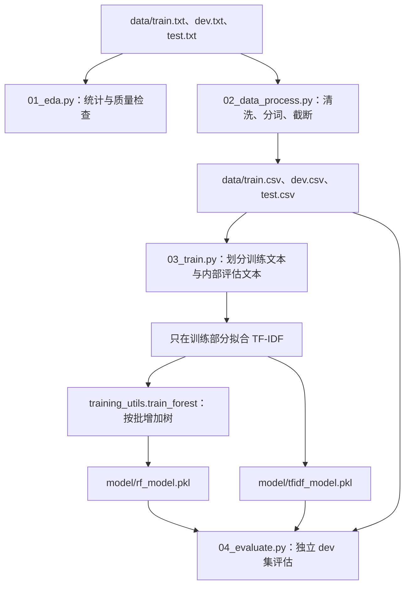
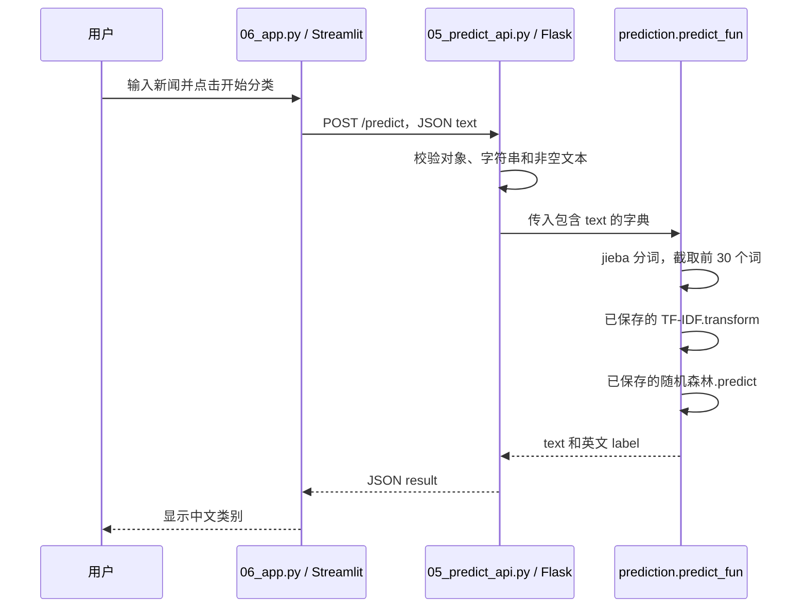

# 投满分项目：中文新闻分类与内容分发开发手册

## 快速运行

以下命令在 **Windows Anaconda Prompt / CMD** 中逐条执行。已有项目时进入现有项目根目录；第一次获取代码时执行：

```bat
git clone https://github.com/fqxxzyw/toumanfen-news-classifier.git
cd toumanfen-news-classifier
```

### 准备环境

已有 `toumanfen` 环境时跳过创建，只需激活并安装依赖：

```bat
conda create -n toumanfen python=3.10 -y
conda activate toumanfen
python -m pip install -r requirements.txt
```

### 已有模型：直接打开演示

确认项目根目录下有配套的 `models`、`models` 和 `data/class.txt`。**已有模型无需重新训练，也无需重新清洗数据。** Git 仓库不包含模型文件，新电脑需自行复制已有模型，或按下一小节生成。

第一个终端，在项目根目录启动分类接口：

```bat
conda activate toumanfen
python src/05_predict_api.py
```

保持接口运行，另开一个终端，进入同一项目根目录后执行：

```bat
conda activate toumanfen
python -m streamlit run src/06_app.py
```

打开 **http://localhost:8501**，输入新闻标题并点击“开始分类”。后端接口为 `http://127.0.0.1:8001/predict`，两项服务需要同时运行。

### 第一次使用、没有模型：先准备数据和模型

原始 TXT、类别表和停用词已在 `data/` 中。需要自行训练时，在项目根目录依次执行：

```bat
python src/01_eda.py
python src/02_data_process.py
python src/03_train.py
python src/04_evaluate.py
```

训练可能耗时较长；完成后按上面的两个终端启动 API 和页面。各步骤的函数、参数、输入输出和产物见后面的完整教程。

> 如果终端已经位于 `src/`，启动命令改为 `python 05_predict_api.py` 和 `python -m streamlit run 06_app.py`，不要重复添加 `src/`。

---

## 完整教程

投满分项目以中文新闻标题、资讯短文本为输入，预测其所属新闻类别，为频道分发、内容标签、用户兴趣分析和推荐系统提供基础数据。本手册按照“业务理解 → 数据治理 → 特征与模型 → 评估 → 接口 → 页面 → 模型扩展 → 业务应用”的顺序说明整个项目，并逐个解释仓库中的函数。

仓库中的可运行链路是 **jieba + TF-IDF + 随机森林 + Flask + Streamlit**。FastText、BERT、LLM 对照、模型压缩及推荐业务在后文给出设计与开发方法；这些章节会明确标为设计内容，不代表仓库中已经存在对应实现。

版本变化、每天完成了什么和发布问题分别查看 [CHANGELOG.md](CHANGELOG.md) 与 [Release 说明](docs/releases/v0.1.0.md)。README 说明项目本身、代码原理和开发方法，不用于记录每天的进度。

## 阅读目录

1. [业务目标与任务定义](#1-业务目标与任务定义)
2. [整体架构与数据流](#2-整体架构与数据流)
3. [目录与文件职责](#3-目录与文件职责)
4. [原始数据、标签和数据约定](#4-原始数据标签和数据约定)
5. [环境安装与运行前准备](#5-环境安装与运行前准备)
6. [统一配置：config.py](#6-统一配置configpy)
7. [步骤一：数据探索与质量分析](#7-步骤一数据探索与质量分析)
8. [步骤二：数据清洗与分词](#8-步骤二数据清洗与分词)
9. [步骤三：TF-IDF 特征与训练入口](#9-步骤三tf-idf-特征与训练入口)
10. [随机森林分批训练与预测工具](#10-随机森林分批训练与预测工具)
11. [步骤四：独立验证集评估](#11-步骤四独立验证集评估)
12. [单条新闻预测模块](#12-单条新闻预测模块)
13. [步骤五：Flask 分类接口](#13-步骤五flask-分类接口)
14. [步骤六：Streamlit 页面](#14-步骤六streamlit-页面)
15. [完整运行顺序与产物检查](#15-完整运行顺序与产物检查)
16. [FastText 模型设计](#16-fasttext-模型设计)
17. [BERT 模型设计](#17-bert-模型设计)
18. [LLM 对照方案设计](#18-llm-对照方案设计)
19. [模型压缩与资源评估设计](#19-模型压缩与资源评估设计)
20. [服务部署、版本管理与监控设计](#20-服务部署版本管理与监控设计)
21. [频道投递、兴趣画像与推荐设计](#21-频道投递兴趣画像与推荐设计)
22. [从零开发的实践顺序](#22-从零开发的实践顺序)
23. [常见错误与定位方法](#23-常见错误与定位方法)
24. [函数索引与参考资料](#24-函数索引与参考资料)

## 1. 业务目标与任务定义

### 1.1 解决什么问题

新闻平台持续接收大量标题和资讯，人工逐条归类成本较高。分类器将文本转换成统一内容标签，下游可据此把新闻放入体育、财经、教育等频道，也可以统计用户偏好的内容类型。

例如，输入“某球队夺得联赛冠军”，系统输出一个类别标识，如 `sports`；页面再将其显示为“体育”。这是响应形式示例，具体结果以实际模型预测为准。

### 1.2 机器学习任务是什么

本项目是**有监督、单标签、十分类的中文短文本分类**：

- 有监督：训练数据同时包含文本和人工给定的类别编号。
- 单标签：每条新闻只预测一个类别，不同时输出多个独立标签。
- 十分类：类别固定为 `class.txt` 中的十类。
- 短文本：训练样本主要是标题，不应将标题分类模型直接等同于长篇新闻全文理解模型。

训练阶段输入“文本 + 标签”，预测阶段只输入文本。分类输出是内容类别，不是情感分数、用户喜好或推荐排序分数。

### 1.3 分类和推荐怎样衔接

分类器回答“这条内容属于哪类”；推荐系统还要结合用户行为、时间、候选内容和排序策略，回答“给哪个用户、在什么位置展示”。分类标签可以作为推荐特征，但单独部署分类接口并不会自动产生个性化推荐。

## 2. 整体架构与数据流

### 2.1 面向整个业务的架构


图中包含项目的完整业务设计。仓库已有代码覆盖数据分析、清洗、随机森林、独立验证、HTTP 分类接口和演示页面；其余模块的输入输出与开发方式见第 16～21 节，不应将架构图当作所有功能已经实现的清单。

### 2.2 现有离线处理链路



### 2.3 现有在线预测链路



在线预测只加载模型和计算结果，不调用 `fit()`，不会因为用户点击按钮而重新训练。

## 3. 目录与文件职责

```text
toumanfen-news-classifier/
├── src/
│   ├── 01_eda.py             # 探索性数据分析
│   ├── 02_data_process.py    # 数据清洗、分词、CSV 导出
│   ├── 03_train.py           # TF-IDF、随机森林、内部评估与保存
│   ├── 04_evaluate.py        # 独立 dev 集评估及文件导出
│   ├── 05_predict_api.py     # Flask HTTP 分类接口，8001
│   ├── 06_app.py             # Streamlit 页面，通常为 8501
│   ├── config.py             # 数据、模型、报告路径配置
│   ├── prediction.py         # 单条文本预测模块
│   └── training_utils.py     # 分批训练、预测与进度条
├── data/
│   ├── train.txt / dev.txt / test.txt  # 原始带标签数据
│   ├── class.txt             # 类别名称顺序
│   ├── stopwords.txt         # 停用词表
│   ├── README.md             # 数据来源与格式说明
│   └── train.csv / dev.csv / test.csv  # 运行清洗脚本后生成
├── model/                    # 生成或自行复制的模型，不提交 Git
│   ├── rf_model.pkl
│   └── tfidf_model.pkl
├── artifacts/                # 生成的图表与评估结果，不提交 Git
│   ├── eda/
│   └── evaluation/
├── docs/                     # 迁移对照、验证记录及发布说明
├── requirements.txt          # Python 依赖
├── VERSION                   # 版本号
├── CHANGELOG.md              # 日期、版本与变更进度
├── .gitignore                # 忽略本地练习、模型和生成物
└── README.md                 # 本开发手册
```

编号文件表示执行顺序；`config.py`、`prediction.py`、`training_utils.py` 是供其他文件导入的模块。编号入口通过 `python src/文件名.py` 执行，不需要把文件名写成 Python 导入语句。

本机另有 `预习/`，保存提前练习的副本，使用自己的 CSV、模型、输出目录和服务端口；它被 Git 忽略，不上传到仓库，也不包含在版本源码包内。具体练习内容见本地 `预习/README.md`。

## 4. 原始数据、标签和数据约定

### 4.1 数据来源与数量

数据为 THUCNews 20 万条新闻标题子集，原始来源和下载说明见 [data/README.md](data/README.md)。

| 文件 | 原始条数 | 用途 |
| --- | ---: | --- |
| `train.txt` | 180000 | 模型开发使用的训练数据 |
| `dev.txt` | 10000 | 独立验证，比较模型或参数 |
| `test.txt` | 10000 | 最终测试，避免参与日常调参 |
| `class.txt` | 10 行 | 类别编号到英文类别的映射 |

上述是原始数据规模。清洗后若删除异常样本，CSV 行数可能变化，应以实际输出为准。

### 4.2 TXT 格式

UTF-8 编码，无表头，每行包含“标题”和“数字标签”，以实际 Tab 分隔：

```text
中国队在比赛中夺得冠军<Tab>7
```

这里的 `<Tab>` 是说明符号。实际文件使用制表符，而不是五个字符 `<Tab>`；普通空格也不能替代字段分隔符。

### 4.3 十个类别的固定顺序

| 标签 ID | 英文类别 | 中文含义 |
| --- | --- | --- |
| 0 | finance | 财经 |
| 1 | realty | 房产 |
| 2 | stocks | 股票 |
| 3 | education | 教育 |
| 4 | science | 科技 |
| 5 | society | 社会 |
| 6 | politics | 时政 |
| 7 | sports | 体育 |
| 8 | game | 游戏 |
| 9 | entertainment | 娱乐 |

`class.txt` 第一行对应 0，不是 1。不要仅调整类别文件顺序而保留旧模型，否则数字预测会映射成错误的业务类别。

### 4.4 清洗后的 CSV 格式

| 字段 | 类型与含义 | 被谁使用 |
| --- | --- | --- |
| `text` | 清洗后的完整标题字符串 | 查看样本、导出预测对照 |
| `label` | 0～9 的整数类别 | 模型训练与指标计算 |
| `words` | 空格分隔的分词文本，最多 30 个词 | TF-IDF 输入 |

示意行如下，实际分词以当前 jieba 输出为准：

```csv
text,label,words
中国队在比赛中夺得冠军,7,中国队 在 比赛 中 夺得 冠军
```

`text` 是完整清洗标题；被截断的是 `words` 中的词序列，不是直接截断前 30 个汉字。

### 4.5 停用词文件

停用词表用于过滤通常不利于区分类别的词。文件可以每行一个词，训练时使用 `f.read().split()` 按任意空白分隔，再用 `set` 去重、`sorted` 固定顺序。

停用词不是模型训练标签，也不是分词词典。清洗脚本生成的 `words` 仍可包含停用词，真正的停用词过滤发生在 TF-IDF 特征提取时。它不会由 `Config()` 自动创建。不要不加分析地删除“不、没有”等可能影响文本含义的词。

### 4.6 两种“评估数据”要分清

`03_train.py` 将 `train.csv` 再分成 80% 训练部分与 20% 内部评估部分。变量虽然叫 `x_test`、`y_test`，但它们不是磁盘上的 `test.csv`。

`04_evaluate.py` 使用单独的 `dev.csv`。最终的 `test.csv` 没有对应的独立评估入口，不能把 dev 指标写成 test 指标。

## 5. 环境安装与运行前准备

### 5.1 获取代码

```bat
git clone https://github.com/fqxxzyw/toumanfen-news-classifier.git
cd toumanfen-news-classifier
```

仓库公开，可直接获取代码。已有本地项目时进入现有目录即可，例如：

```bat
cd /d D:\soft\python\NLP\投满分项目
```

本手册中的 `cd /d` 示例适用于 Windows CMD / Anaconda Prompt；PowerShell 可使用 `Set-Location 'D:\soft\python\NLP\投满分项目'`。

### 5.2 创建并激活环境

```bat
conda create -n toumanfen python=3.10 -y
conda activate toumanfen
python -m pip install -r requirements.txt
```

已有环境时跳过创建。使用 `python -m pip` 是为了让安装目标跟随当前 Python。PyCharm 中也应选择同一解释器，例如 `D:\Anaconda3\envs\toumanfen\python.exe`。

| 依赖 | 在项目中的作用 |
| --- | --- |
| pandas | 读取 TXT / CSV、DataFrame 清洗及结果导出 |
| numpy | 数值统计、`float32`、拼接预测结果 |
| matplotlib、seaborn | 绘制并保存 EDA 图表 |
| jieba | 中文分词 |
| scikit-learn | TF-IDF、数据划分、随机森林、评估指标 |
| tqdm | 训练与预测进度显示 |
| Flask | HTTP 请求解析与 JSON 响应 |
| streamlit | 浏览器交互页面 |
| requests | 页面向 Flask 服务发起请求 |

FastText、PyTorch、Transformers 和 LLM 服务 SDK 不属于现有运行链路，`requirements.txt` 没有为后续设计章节安装这些扩展依赖。

### 5.3 第一次运行和已有模型时的区别

第一次从仓库获取代码：检查原始 TXT 和停用词 → 运行清洗 → 自行训练 → 验证 → 启动 API 和页面。

已经有配套 CSV 和模型：可以直接进入独立验证或启动服务，不需要为了重新打开页面再训练。模型必须是配套的 `rf_model.pkl` 和 `tfidf_model.pkl`；不要把两次训练得到的文件随意混用。

依赖未锁定版本，pickle 模型跨 scikit-learn 版本不保证兼容。保存模型时应同时记录运行环境；只加载自己或可信来源生成的 pickle 文件。

## 6. 统一配置：config.py

源文件：[src/config.py](src/config.py)。该文件管理路径，不负责读数据、创建停用词或训练模型。

### 6.1 `Config.__init__(self)`

**作用：** 创建配置对象时，根据 `config.py` 的实际位置计算项目根目录，并生成供训练、验证和预测使用的路径。

**输入：** 无额外参数，通过 `Config()` 创建。

**返回：** `__init__` 本身不返回配置字典，而是设置实例属性，后续使用 `conf.train_path` 等读取。

关键语句：

```python
PROJECT_PATH = Path(__file__).resolve().parents[1]
```

`__file__` 指当前文件；`resolve()` 获取绝对路径；`parents[0]` 为 `src/`，`parents[1]` 为项目根目录。`parent` 只表示单个父目录，不支持写成 `parent[1]`。

| 属性 | 默认位置 | 主要调用者 |
| --- | --- | --- |
| `train_path` | `data/train.csv` | 训练入口 |
| `dev_path` | `data/dev.csv` | 独立验证入口 |
| `test_path` | `data/test.csv` | 为最终测试保留，现有 dev 脚本不使用它 |
| `stop_words_path` | `data/stopwords.txt` | TF-IDF 训练 |
| `class_name_path` | `data/class.txt` | 在线预测的标签映射 |
| `rf_model_save_path` | `models` | 训练保存、验证及预测加载 |
| `tfidf_model_save_path` | `models` | 训练保存、验证及预测加载 |
| `artifacts_dir` | `artifacts/` | 独立验证结果输出 |

调用示例：

```python
from config import Config

conf = Config()
print(conf.train_path)
```

示例假定代码位于 `src/` 或 `src/` 已在模块搜索路径中。EDA 和清洗脚本没有导入 `Config`，而是在各自文件中根据 `__file__` 构建同一根目录下的数据路径；修改数据布局时要同时检查这两处。

## 7. 步骤一：数据探索与质量分析

源文件：[src/01_eda.py](src/01_eda.py)。EDA 指探索性数据分析：先判断数据是什么样、是否可靠，再考虑模型。

```bat
python src/01_eda.py
```

### 7.1 为什么在训练前做 EDA

需要回答：样本是否够用、类别是否均衡、标题一般多长、有没有空文本、是否有相同文本对应不同标签、训练与验证集合是否有重复内容。

质量检查不会自动修复所有问题。例如脚本报告了跨集合交集，不代表已经重新划分数据。严格评估时，需要根据报告决定去重或重新划分方案。

### 7.2 `load_classes(path: Path) -> list[str]`

**输入：** `class.txt` 路径。**输出：** 按原顺序排列的非空类别名称列表。

处理顺序：检查文件存在 → 按 UTF-8 读取 → 按行拆分 → 去除每行首尾空白和空行 → 检查列表非空 → 检查类别名不重复 → 返回列表。

异常包括文件不存在、没有有效类别、存在重复类别。函数不会排序类别；排序会改变编号对应关系，因此必须保持文件原顺序。

**调用者：** `main()`，得到 `classes`，再将 `len(classes)` 传给数据加载函数用于标签范围校验。

### 7.3 `load_dataset(path: Path, num_classes: int) -> pd.DataFrame`

**输入：** 一个原始 TXT 路径，以及合法类别总数。**输出：** 包含 `sentence`、`label` 的 DataFrame。

主要步骤：

1. 检查文件存在。
2. `pd.read_csv(..., sep='\t', names=['sentence', 'label'], header=None)` 按无表头的两列数据读取。
3. `keep_default_na=False` 保留空字符串，便于后面统计空标题。
4. 将文本转换为字符串并去掉首尾空白。
5. `pd.to_numeric(..., errors='coerce')` 将标签转换成数值；不能转换的内容变为 NaN。
6. 如果存在非数字标签，抛出异常并展示部分异常行。
7. 转成整数，再检查标签是否位于 `0` 到 `num_classes - 1`。

这里遇到异常标签会报错，便于在分析阶段发现问题；它与清洗脚本“删除异常样本”的策略不同。现有实现是在转整数后检查范围，没有独立检查“数值标签是否原本带小数”，因此数据规范仍要求整数标签。

### 7.4 `analyze_split(split_name, df, classes) -> dict`

**输入：** 集合名，如 `train`；该集合的 DataFrame；完整类别列表。**输出：** 一个可写入 JSON 的统计字典，并在控制台打印统计结果。

函数先复制 DataFrame，再新增 `sentence_len`，避免修改调用者的原数据。主要统计项如下：

| 字段 | 统计内容 | 对开发的帮助 |
| --- | --- | --- |
| `sample_count` | 总样本数 | 判断读取是否漏行 |
| `class_count` | 实际出现的类别数 | 判断有无类别缺失 |
| `empty_sentence_count` | 空字符串标题数 | 判断是否需要清理 |
| `duplicate_row_count` | 文本和标签都相同的额外重复行数 | 查看完全重复 |
| `duplicate_text_count` | 只比较文本时的额外重复行数 | 查看内容重复 |
| `conflict_text_count` | 同一文本对应多个不同标签的独特文本数 | 查看标注冲突 |
| `garbled_text_count` | 含 Unicode 替换字符 `�` 的标题数 | 提示疑似乱码 |
| `length` | 长度最小、最大、均值、方差、标准差及分位数 | 判断长度分布 |
| `label_distribution` | 每个编号、英文名、样本数、占比 | 判断类别是否均衡 |

类别统计使用 `value_counts().sort_index().reindex(...)`，使没有出现的类别也能以 0 显示。冲突统计使用 `groupby('sentence')['label'].nunique()`；大于 1 的文本视为同文异标。

`duplicated().sum()` 统计第一次出现之后的额外重复行，不是“所有属于重复组的行”。P95 表示约 95% 的标题长度不超过该值；这里计算的是字符长度，不是 jieba 分词后的词数。乱码检查只识别 `�` 这一种信号，不是完整编码检测器。

### 7.5 `draw_label_distribution(train_df, classes) -> None`

**输入：** 训练集 DataFrame 和类别列表。**输出：** 无业务返回值，保存 `artifacts/eda/label_distribution.png`。

函数先计算各类数量，补齐缺失类别，构造 `class_name`、`count` 两列的绘图表，再通过 `sns.barplot` 生成柱状图。横轴为类别，纵轴为样本数。`tight_layout()` 调整边距，`savefig(..., dpi=160)` 保存图片，最后 `close()` 释放画布。

柱状图用于发现类别失衡，不会自动对样本过采样或改变类别权重。

### 7.6 `draw_text_length_distribution(train_df) -> None`

**输入：** 训练集 DataFrame。**输出：** `artifacts/eda/text_length_distribution.png`。

使用 `.str.len()` 计算标题字符数，通过 `sns.histplot(..., bins=30)` 画直方图，并使用 `plt.axvline` 画出 P95 参考线。它帮助理解标题长度，不能直接把“字符 P95”当成 BERT 的 token 长度阈值。

### 7.7 `check_split_overlap(datasets) -> dict`

**输入：** `{'train': train_df, 'dev': dev_df, 'test': test_df}`。**输出：** `train_dev`、`train_test`、`dev_test` 三对交集的数量和最多 5 条示例。

函数将各集合的 `sentence` 转成 `set`，再用集合交集运算 `&` 找到完全相同的文本。集合内部会自动去重，所以这里的数量是跨集合重复的**独特文本数**，不是重复行总数。

匹配依据是加载后去除首尾空白的字符串，不做语义相似检测；“标题略改几个字”的近重复不会被识别。示例从集合中取出，显示顺序不保证每次一致。

### 7.8 `main() -> None`

主函数只负责组织流程：

```text
load_classes
    → 对 train/dev/test 调用 load_dataset
    → 分别调用 analyze_split
    → check_split_overlap
    → draw_label_distribution
    → draw_text_length_distribution
    → 将 classes、splits、overlap 写入 eda_summary.json
```

最终产物为两张图和一个 `artifacts/eda/eda_summary.json`。该文件中的 `splits` 按集合保存统计字典，`overlap` 保存集合交集检查，便于之后回查数据质量。

## 8. 步骤二：数据清洗与分词

源文件：[src/02_data_process.py](src/02_data_process.py)。目标是把原始两列数据转换成后续训练统一使用的三列 CSV。

```bat
python src/02_data_process.py
```

### 8.1 参数与处理边界

| 常量 | 默认值 | 影响 |
| --- | --- | --- |
| `MAX_WORDS` | 30 | `words` 最多保留的词数 |
| `NUM_CLASSES` | 10 | 合法标签范围为 0～9 |
| `DROP_DUPLICATES` | False | 是否删除单个集合内部文本和标签都相同的重复样本 |

脚本不删除原始 TXT；运行会重新写入三个 CSV。即使打开 `DROP_DUPLICATES`，也不会自动清除 train 与 dev 之间的重复文本，更不会替你重新划分数据。

### 8.2 `read_txt_dataset(file_path) -> pd.DataFrame`

**输入：** 原始 TXT 路径。**输出：** 统一为 `text`、`label` 的两列 DataFrame。

先检查存在性，再尝试带表头读取。若检测到 `sentence,label`，将 `sentence` 改名为 `text`；若是 `text,label`，保持字段；否则按无表头格式重新读取，并指定 `names=['text', 'label']`、`header=None`。

所以第一次读取无表头文件时，第一条样本会暂时被视为表头，但在重新读取时被恢复，不会按这个设计丢掉第一条数据。随后检查字段数量、固定字段顺序，打印样本数与前 10 行。

函数不执行清洗和分词；其调用者是 `main()`，返回值交给后续统计和处理函数。

### 8.3 `show_basic_statistics(data, dataset_name) -> None`

**输入：** 原始 DataFrame 和用于展示的集合名称。**输出：** 只打印，无数据返回值。

使用 `Counter` 统计非空标签数量；计算总条数、实际类别数、各类数量及百分比；将缺失文本填为空字符串后计算字符长度均值与标准差。

它回答“处理前数据长什么样”，不负责修改样本。完整的重复、冲突和跨集合检查在 EDA 中进行，这里只做基础观察。

### 8.4 `clean_text(text) -> str`

**输入：** 单条标题。**输出：** 清洗后的字符串。

| 执行顺序 | 规则 | 示例含义 |
| --- | --- | --- |
| 1 | 转成 `str` | 统一后续正则处理对象 |
| 2 | `r'<[^>]+>'` 替换为空格 | 清除形如 `<b>` 的 HTML 标签 |
| 3 | `r'[\r\n\t]'` 替换为空格 | 合并换行和制表产生的断裂 |
| 4 | `r'[\u200b-\u200f\ufeff]'` 替换为空字符串 | 删除部分零宽字符和 BOM |
| 5 | `r'\ufffd'` 替换为空格 | 处理 Unicode 替换字符 |
| 6 | `r'\s+'` 替换成单个空格 | 压缩连续空白 |
| 7 | `.strip()` | 去掉首尾空白 |

例如输入 `'<b>体育新闻</b>\n  中国队夺冠'`，目标结果为 `'体育新闻 中国队夺冠'`。这是按清洗规则推导的示例，不需要训练模型。

清洗不会恢复已经损坏的汉字，也没有统一删除数字、英文或标点；它也不执行停用词过滤。删除过多数字可能损失日期、比分和价格信息，因此不能把“只保留汉字”当成默认正确方案。

### 8.5 `cut_sentence(text) -> str`

**输入：** 已清洗的单条文本。**输出：** 用单个空格连接的词序列。

`jieba.lcut(text)` 先生成列表；对每个词执行 `strip()`；丢弃处理后为空的词；最后用 `' '.join(word_list)` 拼接。

该函数只负责分词，不负责最多 30 词的约束，不负责过滤停用词。jieba 词典或版本改变，分词结果也可能发生变化。

### 8.6 `truncate_words(words, max_words=MAX_WORDS) -> str`

**输入：** 空格分隔的词序列及最大词数。**输出：** 截断后的空格分隔字符串。

内部是 `words.split()` → `word_list[:max_words]` → `' '.join(...)`。例如 `'中国队 在 比赛 中 夺冠'` 在 `max_words=3` 时变为 `'中国队 在 比赛'`。

截断以词为单位；原始完整标题仍保存在 `text`。上限由清洗常量和传参决定，不能只修改在线预测中的硬编码而不检查训练输入。

### 8.7 `process_dataset(data, dataset_name) -> pd.DataFrame`

**输入：** 含 `text,label` 的 DataFrame 和集合名。**输出：** 含 `text,label,words` 的标准 DataFrame，索引重新从 0 连续排列。

完整处理顺序：

1. 复制输入，记录原始数量。
2. 删除 `text` 或 `label` 为缺失值的行。
3. 将文本统一转为字符串。
4. 标签用 `pd.to_numeric(errors='coerce')` 转换，统计并删除不能转成数字的标签。
5. 将标签转成整数，删除不在 0～9 的样本。
6. 对每行文本调用 `clean_text`，删除清洗后长度为 0 的标题。
7. 如果开启 `DROP_DUPLICATES`，按 `text,label` 两列去重，保留首次出现。
8. 对 `text` 调用 `cut_sentence` 生成 `words`。
9. 对 `words` 调用 `truncate_words`，最多保留 `MAX_WORDS` 个词。
10. 删除分词结果为空的行。
11. 固定列顺序，重置索引，打印处理前后数量和删除量。

该函数使用 `DataFrame.apply` 按行调用处理函数。保留数字标签不代表原始标签完全可信；现有代码同样在转整数前没有单独拒绝小数标签，数据规范仍要求输入整数。

### 8.8 `validate_dataset(data, dataset_name) -> None`

**输入：** 处理后的 DataFrame 和集合名。**输出：** 校验通过时打印信息；不符合要求时抛出 `ValueError`。

校验项包括：列名和顺序恰好为 `['text', 'label', 'words']`；集合不为空；三个字段没有缺失值；标签范围合法；`words.split()` 后的最大词数不超过上限。

函数没有返回“清洗后的新数据”，也不会再修复异常。空字符串样本已经由前面的处理函数过滤；这里对非空的检查主要针对缺失值，不能把它描述成独立的全部数据质量检测。

### 8.9 `save_csv_dataset(data, output_path) -> None`

**输入：** 标准 DataFrame 和输出路径。**输出：** 写入一个 UTF-8 CSV 文件。

如果父目录不存在则创建；再次固定三列顺序；`to_csv(index=False, encoding='utf-8')` 不保存 DataFrame 行索引，避免以后多出 `Unnamed: 0` 一类字段。目标已存在时会覆盖。

### 8.10 `main() -> None`

`path_mapping` 保存训练、验证、测试三组输入输出路径，主函数依次执行：

```text
read_txt_dataset → show_basic_statistics → process_dataset
                → validate_dataset → save_csv_dataset
```

最终产物是 `data/train.csv`、`data/dev.csv`、`data/test.csv`。清洗过程不学习 TF-IDF，也不产生随机森林模型。

## 9. 步骤三：TF-IDF 特征与训练入口

源文件：[src/03_train.py](src/03_train.py)。文件负责组织训练，具体按批增加树的逻辑交给 `training_utils.py`。

### 9.1 文本为什么要先转换成数值

随机森林接收数值特征，不能直接理解“中国队夺冠”这串字符。TF-IDF 将词映射成列，把每条文本表示成一个数值向量。假设词表只有 `中国队、冠军、股票`，一条体育标题可以表示成三个位置上的权重；真实词表通常远大于三个词。

TF 表示词在当前文档中的出现次数；IDF 对出现在大量文档中的常见词降低区分作用。在使用平滑 IDF 的常见配置下：

```text
idf(t) = log((1 + 训练文档总数) / (1 + 含词 t 的训练文档数)) + 1
未归一化的 tfidf(t, d) = 词 t 在文档 d 中的次数 × idf(t)
```

向量器通常还会归一化各行。本代码显式设置分词、停用词、大小写和数值类型，其余配置由安装的 scikit-learn 版本默认值决定。参数定义可参阅 [TfidfVectorizer 官方文档](https://scikit-learn.org/stable/modules/generated/sklearn.feature_extraction.text.TfidfVectorizer.html)。

### 9.2 `positive_int(value) -> int`

**输入：** 命令行参数字符串，例如 `'5'`。**输出：** 大于 0 的整数。

先通过 `int(value)` 转换；若小于 1，抛出 `argparse.ArgumentTypeError`。此函数作为 `parser.add_argument(..., type=positive_int)` 的类型转换器，用于拦截 0 或负数的树数、批大小等参数。

这里的 `--jobs` 也使用该转换器，所以本项目入口只接受正整数，不能直接写 scikit-learn 常见的 `n_jobs=-1`。参数校验只保证正数，不保证任意小的 `--limit` 都足以完成十分类分层划分。

### 9.3 `main(argv=None) -> None`

**输入：** 默认 `None`，此时从命令行读取参数；也可由其他 Python 代码传入参数列表。**输出：** 控制台评估结果和两个模型文件，不返回模型对象。

例如 `main(['--limit', '2000', '--trees', '10'])` 会限制样本并训练 10 棵树。此例说明函数调用方式，不代表查看文档时需要执行它。已有模型时可跳过整个训练步骤。

函数的完整执行顺序如下。

#### 9.3.1 解析参数并构造配置

`argparse.ArgumentParser` 解析参数，之后创建 `Config()`。若传入 `--output-dir`，只调整本次两个模型文件的保存位置；不会永久改写 `config.py`，也不会自动让 API 切换到该目录。

| 参数 | 默认值 | 作用与注意事项 |
| --- | --- | --- |
| `--limit` | `None`，全部数据 | `read_csv(nrows=...)` 读取前 N 条，不是随机抽取 N 条 |
| `--trees` | 100 | 随机森林最终树数 |
| `--trees-per-batch` | 5 | 每次 `fit` 新增的树数 |
| `--jobs` | 2 | 随机森林并行工作数 |
| `--predict-batch-size` | 2000 | 内部评估每批预测条数 |
| `--output-dir` | `Config` 中的 `models` | 指定本次模型输出位置；相对路径相对于运行工作目录 |

#### 9.3.2 加载训练 CSV

`pd.read_csv(conf.train_path, nrows=args.limit)` 读取数据，`words = data['words'].fillna('')` 作为模型输入，`labels = data['label']` 作为目标。

如果没有先清洗，通常会缺少 CSV 或 `words` 字段。这里不重新读取原始 TXT，也不重新调用 jieba。

#### 9.3.3 读取停用词并创建向量器

```python
with open(conf.stop_words_path, encoding='utf-8-sig') as f:
    stop_words = sorted(set(f.read().split()))

tfidf = TfidfVectorizer(
    stop_words=stop_words,
    tokenizer=str.split,
    token_pattern=None,
    lowercase=False,
    dtype=np.float32,
)
```

各参数在本项目中的作用：

- `utf-8-sig`：兼容文件开头可能存在的 UTF-8 BOM。
- `str.split`：数据已经分词，按空白读取词，不再用默认正则重新切词。
- `token_pattern=None`：不使用默认词模式，配合自定义 tokenizer。
- `lowercase=False`：不额外转小写，使文本与停用词按相同大小写规则匹配。
- `float32`：特征权重使用 32 位浮点数，降低特征数组的占用。

自定义 tokenizer 也避免默认词模式忽略单字词的问题。它不是再次调用 jieba，因此传给它的应是 `words`，不是未分词的中文长字符串。

#### 9.3.4 先划分文本，再拟合 TF-IDF

```python
train_words, test_words, y_train, y_test = train_test_split(
    words, labels,
    test_size=0.2,
    random_state=42,
    stratify=labels,
)
x_train = tfidf.fit_transform(train_words)
x_test = tfidf.transform(test_words)
```

`test_size=0.2` 表示内部留出 20%；`stratify=labels` 尽量保持各类别比例；固定随机种子便于复现同样的划分。

`fit_transform` 既学习训练词表和 IDF，又生成特征；`transform` 只应用已经学到的规则。内部评估、dev、test 和在线输入都只能使用后者，不能各自再 `fit` 一个新词表。

如果先对全数据拟合再划分，内部评估文本的信息会进入特征规则；即便没有把评估标签交给分类器，也会产生不合理的信息泄漏。

#### 9.3.5 调用分批训练

```python
model = train_forest(
    x_train, y_train,
    total_trees=args.trees,
    trees_per_batch=args.trees_per_batch,
    n_jobs=args.jobs,
)
```

返回值是已经训练完成的 `RandomForestClassifier`。`main` 不自己写决策树逻辑，也不逐行训练文本。

#### 9.3.6 内部评估

调用 `predict_batches(model, x_test, batch_size=...)` 得到一维预测标签数组 `y_pred`，随后计算 Accuracy、Macro-Precision、Macro-Recall、Macro-F1。

本入口将指标打印到控制台，没有将这组内部评估指标自动写入 JSON。第四步写出的 JSON 属于独立 dev 集，二者不可混淆。

#### 9.3.7 保存两个模型

`Path.mkdir(parents=True, exist_ok=True)` 确保输出目录存在，再通过 `pickle.dump` 分别保存分类器和向量器：

| 文件 | 保存什么 | 为什么必须保留 |
| --- | --- | --- |
| `rf_model.pkl` | 已训练的决策树及分类器参数 | 根据特征预测数字类别 |
| `tfidf_model.pkl` | 训练得到的词表、IDF 及预处理配置 | 将新文本转换为相同列顺序的特征 |

若用新词表生成特征，再交给旧分类器，可能发生维度错误；即使列数刚好相同，列含义不一致也会造成错误预测。两个文件应视为同一份模型发布物。

现有保存方式逐个写文件，不是一个原子事务；进程中途退出可能只更新其中一个。正式服务应在训练完成并验证配套文件后再切换，不要一边写模型一边让新服务读取。

### 9.4 稀疏特征与内存

多数标题只包含少量词，词表中绝大多数列在该行权重为 0。稀疏矩阵主要保存非零值及其位置，避免为所有零分配数值存储。

如果将 `180000 × 112604` 的完整 `float64` 矩阵转成稠密数组，仅数值部分就约为：

```text
180000 × 112604 × 8 / 1024³ ≈ 151 GiB
```

写 `X.toarray()[:5]` 会先转换全矩阵，再切五行；正确的查看方式是先截取，例如 `X[:5, :20].toarray()`。即使改用 `float32`，完整稠密矩阵仍然很大，不能代替稀疏存储。

## 10. 随机森林分批训练与预测工具

源文件：[src/training_utils.py](src/training_utils.py)。两个函数分别解决训练反馈和预测批处理问题。

### 10.1 随机森林在做什么

森林由多棵决策树组成。训练时，每棵树通过抽样数据及候选特征形成不同的划分。scikit-learn 的分类森林根据各树的类别概率进行平均，再选择结果类别；不能把实现细节简单理解为项目代码手写了一个硬投票循环。

TF-IDF 列非常多，树可能较深，森林可能占用大量内存和磁盘。进度条用于观察工作状态，不表示模型本身已经压缩。

### 10.2 `train_forest(x_train, y_train, total_trees=100, trees_per_batch=5, n_jobs=2)`

**输入：**

| 参数 | 预期内容 |
| --- | --- |
| `x_train` | 支持 `.tocsc()` 的稀疏特征矩阵，行数为样本数 |
| `y_train` | 与矩阵每行对齐的数字标签 |
| `total_trees` | 希望最终得到的树数，必须大于 0 |
| `trees_per_batch` | 每批增加的树数，必须大于 0 |
| `n_jobs` | 交给随机森林的并行工作数 |

**输出：** 训练完成的 `RandomForestClassifier` 对象。

算法步骤：

1. 校验树数和每批树数为正。
2. 创建 `RandomForestClassifier(n_estimators=1, warm_start=True, random_state=42, n_jobs=n_jobs)`。
3. 将矩阵转换为 CSC 格式并排序索引，避免每批训练都重复转换。
4. 创建以总树数为目标的 tqdm 进度条。
5. 令 `target = min(completed + trees_per_batch, total_trees)`。
6. 设置 `n_estimators=target`，对相同的 `x_train,y_train` 调用 `fit`。
7. 由于启用 `warm_start`，保留已有树，只增加本批缺少的树。
8. 本批完成后更新进度，再继续下一批。

例如总数为 12、每批为 5，累计树数是 `5 → 10 → 12`，不会多训练到 15。官方参数含义见 [RandomForestClassifier 文档](https://scikit-learn.org/stable/modules/generated/sklearn.ensemble.RandomForestClassifier.html)。

### 10.3 “分批训练”具体意味着什么

这里按**树**分批，不是把训练集分成不同块分别喂给模型。每批仍使用相同的完整训练部分，已经训练过的树不重新学习新数据。

- 不是 SGD 的 mini-batch，也没有调用 `partial_fit`。
- 没有将每一批单独保存成 checkpoint，不支持关掉进程后自动续训。
- 森林仍累计保留所有树，批处理并不会消除最终模型体积。
- 每批完成后才更新树数，首批训练期间进度可能停在 0%。

想更频繁看到更新，可以减小 `--trees-per-batch`；这可能增加重复调用的开销，不能承诺加速。`n_jobs` 增大也可能提高内存占用，不能简单认为越大越好。

### 10.4 `predict_batches(model, features, batch_size=2000) -> np.ndarray`

**输入：** 已训练模型、待预测的稀疏矩阵，以及每批行数。**输出：** 按原样本顺序排列的一维数字标签数组。

先校验 `batch_size > 0`；用 `range(0, n_samples, batch_size)` 枚举起始行；对每个切片调用 `model.predict`；更新已预测行数；最后 `np.concatenate` 拼接各批结果。

例如 4500 条数据、每批 2000 条，实际预测三批：2000、2000、500。若矩阵没有样本，函数返回与 `model.classes_` 类型一致的空数组。

调用者包括训练入口的内部评估，以及 `04_evaluate.py` 的独立验证。它只分批执行预测，不修改模型，也不会改变样本顺序。

## 11. 步骤四：独立验证集评估

源文件：[src/04_evaluate.py](src/04_evaluate.py)。

```bat
python src/04_evaluate.py
```

### 11.1 文件执行方式

该文件目前是**顶层顺序执行的脚本**，没有定义独立的 `evaluate_model()` 或 `main()`。直接运行会立即加载模型、读取 dev CSV、预测并写报告；把它当普通模块导入也会触发这些操作。

不要在理解代码时寻找并不存在的自定义评估函数。它调用的是 scikit-learn 指标函数和项目中的 `predict_batches`。

### 11.2 处理流程

1. 创建配置，加载 `rf_model.pkl` 和 `tfidf_model.pkl`。
2. 读取 `dev.csv`，取 `words` 并将缺失值填成空字符串。
3. 调用已保存向量器的 `transform`，不重新拟合。
4. 调用 `predict_batches` 得到 `dev_pred`。
5. 将结果写入 DataFrame 的 `pred` 列。
6. 计算四个指标，保存预测表及指标 JSON。

模型加载时可以只做预测；不需要重新运行第三步。评估必须确保向量器和分类器来自同一轮训练。

### 11.3 四个指标的意义

对一个类别 k：TP 表示正确预测为 k 的数量；FP 表示误判为 k 的数量；FN 表示本来属于 k 却被判成其他类别的数量。

```text
Accuracy = 全部预测正确的样本数 / 总样本数
Precision_k = TP_k / (TP_k + FP_k)
Recall_k = TP_k / (TP_k + FN_k)
F1_k = 2 × Precision_k × Recall_k / (Precision_k + Recall_k)
Macro-Precision = 十个类别 Precision_k 的算术平均
Macro-Recall = 十个类别 Recall_k 的算术平均
Macro-F1 = 十个类别 F1_k 的算术平均
```

Macro-F1 不是先对 Precision、Recall 做宏平均再计算一次 F1。当前指标调用没有显式传入 `labels=range(10)`，因此库默认根据实际标签推断参与平均的类别；在包含全部十类的 dev 集上就是十类平均，小样本缺类时需注意该差别。

`average='macro'` 适用于这里的多分类统计；默认的 `'binary'` 会导致十分类报错。`zero_division=0` 在出现零分母时将对应指标设为 0，避免结果不明确。

### 11.4 输出文件和字段

| 文件 | 内容 |
| --- | --- |
| `artifacts/evaluation/dev_predictions.csv` | `text,label,words,pred`，便于筛选预测错误样本 |
| `artifacts/evaluation/dev_metrics.json` | 集合名、数量、准确率、宏平均精确率、召回率和 F1 |

指标 JSON 的字段为 `dataset`、`samples`、`accuracy`、`precision_macro`、`recall_macro`、`f1_macro`。其中分数范围通常是 0～1，换成百分比需乘 100。

### 11.5 如何做错误分析

读取预测表，筛选 `label != pred`；结合 `class.txt` 查看真实类别和预测类别；按“真实类 → 预测类”统计混淆。对典型错误回查：文本是否缺信息、标签是否冲突、词被停用词过滤了吗、训练样本中是否缺少类似表达。

混淆矩阵、每类报告和错误归因统计是后续分析方法，现有第四步没有自动生成它们。不能把这里的开发建议写成脚本已有产物。

## 12. 单条新闻预测模块

源文件：[src/prediction.py](src/prediction.py)，主要供 API 导入。

### 12.1 模块导入阶段

模块在顶层创建配置并执行两次 `pickle.load`，因此 `from prediction import predict_fun` 时就会加载整个分类器和向量器。模型在进程内复用，不是在每个请求中重新加载。

如果模型文件不存在、损坏或不兼容，错误可能出现在 Flask 服务启动之前；这种情况不是页面按钮或 HTTP 超时设置能够修复的。

### 12.2 `predict_fun(data) -> dict`

**输入：** 包含字符串 `text` 的字典，如 `{'text': '中国队夺冠'}`。该函数本身不做完整的输入校验，正常的请求校验由 API 完成。

**输出：** 在原字典上新增或覆盖 `label` 后返回同一字典，例如 `{'text': '中国队夺冠', 'label': 'sports'}`。函数会修改传入对象，不是返回一个完全独立的副本。

执行过程：

1. `jieba.lcut(data['text'])` 得到分词列表。
2. 取前 30 个列表元素，用空格拼接成字符串。
3. `tfidf_model.transform([word])` 把单条文本作为长度为 1 的文档列表输入。
4. `rf_model.predict(x)[0]` 取第一个预测标签。
5. 逐行读取类别文件，用 `enumerate` 构造 `id2class`。
6. 将数字标签转为英文类别，写入 `data['label']` 并返回。

`transform` 的输入写成 `[word]` 是因为向量器接收文档集合；直接传一个字符串容易被误当成错误类型。`[0]` 则把只含一个预测结果的数组取为单个标签。

### 12.3 与离线清洗的实际差别

现有在线函数没有调用 `clean_text`，也没有像离线 `cut_sentence` 那样先过滤空白词，再截断。因此“API 去掉首尾空白”不等于“在线与离线执行了完全相同的清洗”。HTML、特殊空白等输入可能表现不同。

修改预处理时应考虑提取公共函数，让训练和预测共享同一规则；这是代码改进方向，本手册不假称当前已经统一。预测函数中的 30 是硬编码，修改清洗脚本的 `MAX_WORDS` 不会自动更新它。

### 12.4 返回值中没有什么

函数只返回文本和最终类别，没有返回概率、Top-K、置信度校准值、模型版本或耗时。页面显示的英文类别也不是概率分数。新增这些字段需要修改预测模块、接口约定及页面解析，不能只在 README 中承诺。

## 13. 步骤五：Flask 分类接口

源文件：[src/05_predict_api.py](src/05_predict_api.py)。

```bat
python src/05_predict_api.py
```

服务绑定本机 `127.0.0.1:8001`。它是本地开发服务，不是完整生产部署。

### 13.1 `app = Flask(__name__)` 和路由

`Flask(__name__)` 创建应用对象。装饰器 `@app.route('/predict', methods=['POST'])` 将特定 URL 和 HTTP 方法绑定到下面的 `predict_api` 函数。

路由只有 POST `/predict`。访问 `/` 没有首页路由，浏览器直接打开通常得到 404；直接在地址栏访问 `/predict` 发出 GET，请求方法不匹配通常得到 405。这些情况不能直接证明分类服务未启动。

### 13.2 `predict_api()`

**输入：** Flask 当前请求中的 JSON，而不是普通 Python 函数位置参数。**输出：** JSON 响应与状态码。

具体步骤：

1. `request.get_json(silent=True)` 尝试解析 JSON。解析失败或请求不是预期 JSON 时，不在这一行主动抛出解析错误，而是交由后续校验。
2. 检查 `data` 是字典。
3. 检查 `data.get('text')` 是字符串。
4. 检查 `.strip()` 后不为空。
5. 校验不通过时返回 `{'error': 'Invalid data'}` 和 HTTP 400。
6. 去掉文本首尾空白，调用 `predict_fun(data)`。
7. 使用 `jsonify({'result': result})` 返回 JSON 和 HTTP 200。

短路逻辑先判断对象与字符串类型，再调用 `.strip()`，避免对数字、列表等错误类型执行字符串方法。Flask API 行为可查阅 [官方 API 文档](https://flask.palletsprojects.com/en/stable/api/)。

### 13.3 请求与响应约定

| 项目 | 约定 |
| --- | --- |
| 地址 | `http://127.0.0.1:8001/predict` |
| 方法 | POST |
| Content-Type | `application/json` |
| 必需字段 | `text`，非空字符串 |
| 成功状态 | 200 |
| 输入错误状态 | 400 |
| 成功结果位置 | `result.label`，英文类别名 |

请求：

```json
{"text": "中国队在比赛中夺得冠军"}
```

成功响应示例，类别取决于实际模型：

```json
{
  "result": {
    "text": "中国队在比赛中夺得冠军",
    "label": "sports"
  }
}
```

输入错误响应：

```json
{"error": "Invalid data"}
```

这个接口不使用 `request.form` 解析表单。`requests.post(url, json=...)` 会按 JSON 发送；改用 `data=...` 发送表单并不自动符合本接口约定。

### 13.4 手动调用示例

在已激活环境、接口正在运行时，可以用一个单独 Python 文件执行：

```python
import requests

response = requests.post(
    'http://127.0.0.1:8001/predict',
    json={'text': '中国队在比赛中夺得冠军'},
    timeout=(5, 60),
)
response.raise_for_status()
print(response.json())
```

该示例只发起预测，不训练模型。不要将 Python 多行代码逐行当 CMD 命令执行。

### 13.5 异常处理边界

API 只显式处理输入校验，没有为模型计算异常、模型文件异常或映射异常定义统一 JSON 错误体。运行中发生未捕获异常可能返回 Flask 的 500 响应，内容不一定是 JSON。

网页因此会先检查 HTTP 状态，而不是假设每种错误都能读取 `response.json()['error']`。生产化时还需要请求长度限制、日志、健康检查和统一异常处理，不能只靠前端的 2000 字限制保护接口。

## 14. 步骤六：Streamlit 页面

源文件：[src/06_app.py](src/06_app.py)。API 保持运行，另开终端：

```bat
python -m streamlit run src/06_app.py
```

默认访问 `http://localhost:8501`。端口若被占用，查看实际启动输出或显式使用 `--server.port`。

### 14.1 `API_URL` 与 `CLASS_NAMES`

`API_URL` 指定后端地址，默认是 8001 的 `/predict`。修改 Flask 端口时必须同步修改此处；浏览器中页面的 8501 是另一项服务，不是分类 API 的端口。

`CLASS_NAMES` 将十个英文标识映射成中文显示名。它用于展示，不参与模型训练；对没有写入映射表的标签，页面回退显示原标签。

### 14.2 `request_prediction(text) -> dict`

**输入：** 已去除首尾空白的新闻字符串。**输出：** `{'text': text, 'label': label}`。

它承担页面与接口之间的数据转换：

1. `requests.post(API_URL, json={'text': text}, timeout=(5, 60))` 发起请求。
2. `raise_for_status()` 对 HTTP 错误状态抛出异常。
3. `response.json()` 解析响应。
4. 校验最外层必须是字典。
5. 校验 `result` 必须是字典。
6. 校验 `result.label` 为非空字符串。
7. 返回以提交文本和有效标签组成的结果字典。

`timeout=(5,60)` 分别表示连接和读取超时设置，不是“全程严格最多 65 秒”的总时限保证。网络超时、HTTP 错误或 JSON / 结构异常交给调用者处理，不在函数里伪造一个分类结果。

### 14.3 `main() -> None`

页面主函数的流程：设置标题与图标 → 侧边栏说明 → 输入表单 → 提交校验 → 调用接口 → 保存结果 → 显示结果。

主要 Streamlit 调用如下：

| 调用 | 作用 |
| --- | --- |
| `st.set_page_config` | 设置浏览器页面标题和图标 |
| `st.title`、`st.caption` | 显示页面标题与简短说明 |
| `st.sidebar` | 显示类别、输入建议和启动命令 |
| `st.form('news_form')` | 将输入和按钮作为一次提交 |
| `st.text_area` | 多行输入，界面上限制 2000 个字符 |
| `st.form_submit_button` | 用户明确点击后才进入分类逻辑 |
| `st.spinner` | 请求期间显示等待提示 |
| `st.session_state` | 跨页面脚本重跑保存本次会话结果 |
| `st.warning`、`st.error`、`st.success` | 分别显示输入提醒、错误和分类成功 |
| `st.text` | 按文本展示提交内容 |

使用 form 的原因：避免把用户每次输入变化都当成一次 API 分类提交。表单行为见 [Streamlit 官方说明](https://docs.streamlit.io/develop/concepts/architecture/forms)。

### 14.4 会话状态怎样防止旧结果误导

每次提交先调用 `st.session_state.pop('prediction', None)` 清除旧结果。空输入、超时或连接失败时，不再继续显示上一条新闻的成功分类；成功时把 `request_prediction` 返回值存入 `prediction`。

`st.session_state.get('prediction')` 用于在本次会话的脚本重跑后继续显示结果。它不是数据库，不提供跨浏览器、跨用户的持久历史记录，也不等于已经实现用户画像。

### 14.5 页面处理的错误

| 异常或情况 | 页面行为 |
| --- | --- |
| 输入为空或只有空白 | 提示先输入，不发送请求 |
| `Timeout` | 提示请求超时 |
| `ConnectionError` | 提示启动分类服务 |
| `HTTPError` | 展示状态码并提示查看 API 日志 |
| `ValueError` | 提示返回 JSON 或 `result.label` 结构异常 |
| 其他 `RequestException` | 提示请求失败 |

当前页面不显示概率条、Top-K、历史记录或模型切换，这些功能需要对应的接口与状态设计。

## 15. 完整运行顺序与产物检查

### 15.1 只有源码、准备从零跑通

激活环境、进入项目根目录后，按需要逐条执行：

```bat
python src/01_eda.py
python src/02_data_process.py
python src/03_train.py
python src/04_evaluate.py
```

训练是需要主动选择的耗时操作。已有配套模型和 CSV 时，跳过清洗与训练即可；本手册列出开发步骤不代表要求每次启动都重做。

先启动 API：

```bat
python src/05_predict_api.py
```

另一个终端激活同一环境，进入同一根目录，再启动页面：

```bat
python -m streamlit run src/06_app.py
```

### 15.2 已有模型，只想打开演示

确认项目根目录 `models` 中有两个配套 `.pkl`，`data/` 中有 `class.txt`。API 使用向量器中已经保存的停用词配置，启动预测并不重新读取停用词文件来拟合。

只运行第五、六步即可。页面通过 HTTP 调用 API，两个终端都需要保持运行。关闭页面服务不会自动关闭 API，关闭 API 则页面无法继续预测。

### 15.3 当前目录已经是 src

```bat
python 05_predict_api.py
```

另一个同样位于 `src/` 的终端：

```bat
python -m streamlit run 06_app.py
```

不要再写一层 `src/`，也不要把两条启动命令首尾粘在一起。

### 15.4 可选的小样本练习命令

当你之后自己想验证训练过程时，可使用单独输出目录：

```bat
python src/03_train.py --limit 2000 --trees 10 --trees-per-batch 2 --jobs 1 --output-dir model/quick_check
```

这是练习命令，不会自动替换正式 API 的默认模型。`--limit` 读取前 N 行，过小或缺类的数据可能不满足分层划分要求。若不打算训练，不需要运行此命令。

### 15.5 每一步应该看到什么

| 步骤 | 主要输入 | 主要产物 | 完成判断 |
| --- | --- | --- | --- |
| 01 | 三个原始 TXT 和 class | 两张图、EDA JSON | 查看样本量、类别和交集统计 |
| 02 | 三个原始 TXT | 三个 CSV | 字段通过校验，`words` 词数符合上限 |
| 03 | train CSV、stopwords | 两个配套模型 | 打印内部指标并完成保存 |
| 04 | dev CSV、两个模型 | dev 预测表和指标 JSON | 预测行数与 dev 输入一致 |
| 05 | 两个模型、class | 运行中的 HTTP 服务 | 合法 POST 返回 `result.label` |
| 06 | 运行中的 API | 浏览器页面 | 提交文本能显示结果或明确错误 |

这些产物反映各步骤是否运行，不自动证明模型质量达标。完整项目应另外记录验证方案和实际指标，不能用接口返回 200 代替模型评估。

## 16. FastText 模型设计

**本节是整体项目的模型扩展设计；当前 `src/` 没有 FastText 训练、预测或数据导出文件。** 目的是说明为什么引入第二条模型路线，以及后续具体开发顺序。

### 16.1 为什么与随机森林对比

随机森林基线使用高维稀疏词特征。FastText 提供另一种文本分类建模方式，可作为速度、效果和体积的对照。是否更适合本数据，需要在相同划分和指标下测量，不能直接引用教学截图中的准确率作为本项目成绩。

### 16.2 数据适配

FastText 监督分类常用每行“标签 + 文本”的训练格式，标签前缀为 `__label__`：

```text
__label__sports 中国队 在 比赛 中 夺得 冠军
__label__finance 某 公司 发布 年度 财务 报告
```

从 `label` 数字编号映射到英文类别后导出，并清理文本中的换行，保证一条样本对应一行。训练、dev、test 使用同一映射，不能分别生成顺序不同的标签列表。

词级输入可以沿用 jieba 分词结果；若设计字符级实验，需要显式制定按字符展开的规则。词 n-gram、字符子词特征与“把整句改成字符序列”是不同的实验配置，不应混为一谈。格式与接口可参考 [FastText 官方分类教程](https://fasttext.cc/docs/en/supervised-tutorial.html)。

### 16.3 建议的函数分工

以下是**待实现的接口设计**，不是可直接导入的现有函数：

| 建议函数 | 输入 | 处理内容 | 输出 |
| --- | --- | --- | --- |
| `export_fasttext_dataset` | 标准 DataFrame、标签映射、目标路径 | 转换标签前缀，规范一行一条文本 | FastText 格式文件 |
| `train_fasttext_model` | 训练文件、训练参数 | 调用 FastText 训练并记录配置 | 训练后的模型和参数记录 |
| `evaluate_fasttext_model` | 模型、独立 dev 数据 | 得到每条预测并统一计算四个指标 | 指标与预测对照表 |
| `predict_fasttext_text` | 模型、文本、标签规则 | 执行与训练一致的文本转换及预测 | 统一类别结果 |

### 16.4 实验步骤与验收

先验证数据导出前后条数一致、标签合法；再用小数据检查训练和加载；固定划分后比较学习参数与 n-gram 配置；最后导出与随机森林同字段的预测表，分析各类收益和错误。

需要共同记录训练时长、单条延迟、批量吞吐、模型大小和 Macro-F1。不要只比较 Accuracy，也不要因某次模型体积较小就直接认定满足部署要求。

## 17. BERT 模型设计

**本节是预训练语言模型微调的设计；当前仓库没有 BERT 模型权重、Dataset、训练循环或服务适配。**

### 17.1 输入方式为什么不同

BERT 类模型使用对应的预训练 tokenizer，将原始或规范化文本转换成 token ID、注意力掩码等张量。它不使用随机森林的 TF-IDF 向量器，也不能把 `tfidf_model.pkl` 当作 BERT tokenizer。

“最多 30 个 jieba 词”“最多 N 个汉字”和“最多 N 个 tokenizer token”是不同的长度约束。BERT 实验应根据实际 token 长度分布制定上限，并记录所选预训练模型及 tokenizer 版本。原理来源见 [BERT 原始论文](https://aclanthology.org/N19-1423/)。

### 17.2 数据和训练流程

使用同一套经过质量检查的文本、标签和划分；tokenizer 处理文本并生成张量；分类头输出十个类别分数；使用监督目标优化训练参数。训练阶段按样本 mini-batch 更新神经网络参数，与随机森林按批增加树的方式不同。

验证阶段切换评估模式，关闭梯度计算；将预测映射回与原始标签一致的 ID；在同一 dev 集计算指标；根据 dev 选择模型，再单独进行最终测试。

### 17.3 建议的函数和类

下表全部为**后续开发设计**：

| 组件 | 作用 | 输入与输出 |
| --- | --- | --- |
| `NewsDataset` | 保存文本与标签，按索引提供样本 | 文本标签列表 → 单条张量样本 |
| `tokenize_batch` | 批量分词编码、截断和填充 | 文本列表 → tokenizer 张量字典 |
| `train_one_epoch` | 执行一个训练轮次，更新参数 | 模型、训练批次、优化器 → 训练损失统计 |
| `evaluate_bert_model` | 固定模型进行验证，不更新权重 | 模型、dev 批次 → 预测和统一指标 |
| `save_bert_bundle` | 保存模型、tokenizer、标签映射和参数 | 当前训练产物 → 可整体加载的模型目录 |
| `predict_bert_text` | 执行单条或批量推理 | 配套模型与 tokenizer、文本 → 类别结果 |

开发时需要分别测试数据形状、标签范围、前向输出维度、保存加载前后的预测一致性。记录批大小、学习率、训练轮数、最大 token 长度、随机种子和硬件条件，才能解释速度与效果差异。

### 17.4 与现有接口衔接

模型内部可以不同，但业务层应统一返回类别标识。若新增模型切换，需要建立统一预测接口和模型注册逻辑；不能让页面分别猜测每个模型的原始返回格式。

训练用的模型目录必须包含 tokenizer 和标签映射。只保存一个神经网络权重文件而遗失文本编码规则，同样不能保证新文本预测正确。

## 18. LLM 对照方案设计

**本节为零样本或少样本分类实验设计；仓库没有调用任何 LLM 服务，也不需要为现有随机森林页面配置 LLM 密钥。**

### 18.1 实验目的

在相同类别定义下，观察通用语言模型能否直接给标题分类，分析其与专用分类器的准确性、延迟、费用和稳定性差异。LLM 不是只要放入架构图就会自动参与现有预测。

### 18.2 输入输出约定

输入需要明确给出十个允许的英文类别、每类含义、待分类标题和预期的结构化输出。零样本不附示例；少样本示例应来自训练部分，不能拿 dev 或 test 的正确答案充当提示词示例。

期望返回可以设计为：

```json
{"label": "sports"}
```

这是实验约定，实际服务输出仍要校验。不能把一段解释文字随意截取成类别，也不能把模型自报的“置信度”直接等同于经过校准的分类概率。

### 18.3 建议的函数分工

| 待实现函数 | 作用 |
| --- | --- |
| `build_classification_prompt` | 根据类别定义与实验方案构造提示，隔离待分类文本和任务要求 |
| `call_llm_classifier` | 执行外部调用或本地推理，记录模型、延迟、超时与调用信息 |
| `parse_llm_label` | 解析结构化结果，校验标签属于白名单，保留失败原因 |
| `evaluate_llm_results` | 与真实标签逐条对齐，同时统计正确率和失败率 |

### 18.4 公平比较需要记录什么

固定模型标识、提示词版本、示例来源、采样设置和评估样本；保存原始响应与解析结果，区分预测错误、结构错误、超时与请求失败。

不能把失败请求从分母中悄悄删除后，与其他模型完整样本指标比较。使用外部服务还应统计调用量、费用和网络条件；具体服务接入是另外的实现工作，不在本手册中虚构可运行命令。

## 19. 模型压缩与资源评估设计

**本节说明完整项目中的优化阶段；当前分批训练不是量化、蒸馏或剪枝实现。**

### 19.1 为什么需要这一阶段

分类效果相近的两个模型，可能在加载速度、内存、磁盘体积和单条延迟上差异很大。部署前应把这些指标与业务预算一起评估，而不是只挑 Accuracy 最大的一项。

### 19.2 先建立资源基线

| 测量项 | 测量含义 | 注意事项 |
| --- | --- | --- |
| 模型文件体积 | 配套发布物的总字节数 | 同时计算向量器、tokenizer 等必要文件 |
| 加载时间 | 从开始加载到可接收预测的时间 | 区分冷启动与进程内复用 |
| 单条延迟 | 一条文本从预处理到预测完成的耗时 | 记录硬件、文本长度和预热方式 |
| P50 / P95 延迟 | 多次请求耗时的中位数、95 分位数 | 不能用一次请求代表稳定延迟 |
| 批量吞吐 | 单位时间完成的样本数 | 固定批大小和并发条件 |
| 峰值内存 | 加载与预测期间的最大资源占用 | 不能用文件体积代替内存测量 |
| 分类指标 | 优化前后的 Accuracy 和 Macro-F1 | 固定相同验证数据 |

### 19.3 随机森林可以怎样缩小

可在独立验证方案下研究减少树数、限制树深、增加叶子最小样本数或减少特征等方案。现有命令行直接支持调整树数，但没有为所有树参数暴露选项。

每个方案都需要重新评估效果与资源开销，不能直接删掉部分模型文件内容。ZIP 压缩只减少传输或存储体积，解压加载后不会自然变成更小的森林内存占用。

### 19.4 神经网络量化

量化可用于某些支持的神经网络层，是否适用取决于模型结构和运行后端。不能把 PyTorch 的动态量化接口直接传给 scikit-learn 的 `RandomForestClassifier`。

具体支持范围以选定版本的 [PyTorch 量化文档](https://docs.pytorch.org/docs/stable/quantization-support.html) 为准。实施前应确认算子支持，实施后验证同样的输入格式、输出类别和部署环境。

### 19.5 知识蒸馏与剪枝

知识蒸馏：用较强教师模型提供训练信号，让较小学生模型学习；需要设计学生结构、训练目标、训练数据和评估方案。

剪枝：去掉某些参数、连接或结构；具体能否减少实际延迟取决于部署系统是否利用了这种结构变化。参数数量减少不必然等于运行更快。

这两项都不是现有代码的一键开关。若之后实现，建议提供独立的优化函数和对照报告，保留优化前模型。

### 19.6 建议的资源评估接口

| 待实现组件 | 责任 |
| --- | --- |
| `benchmark_predictor` | 对固定样本、预热和批大小测延迟、吞吐 |
| `measure_bundle_size` | 统计完整模型发布目录而非单个权重文件 |
| `compare_model_variants` | 汇总各模型的效果与资源指标 |
| 压缩适配器 | 根据模型类型执行其支持的量化、蒸馏或结构优化 |

验收不能只写“压缩成功”，而应说明体积变化、延迟变化、指标变化，以及在什么硬件和数据条件下测得。

## 20. 服务部署、版本管理与监控设计

现有第五、六步是本地开发服务。本节补充把整个分类系统作为长期服务时需要设计的组件，不代表这些生产能力已由 Flask 的启动命令提供。

### 20.1 一次模型发布应包含哪些内容

模型发布包应保存分类器或权重、文本编码器、标签映射、预处理规则版本、训练参数、依赖环境、验证指标及文件校验值。

`VERSION` 是代码版本；`docs/MODEL_ARTIFACTS.json` 记录现有本地模型文件信息。代码版本与模型训练轮次不是天然相同，不能因为仓库打了一个 tag，就认为模型已经用该 tag 的全部代码重新训练。

### 20.2 建议的模型加载与切换方式

先在单独目录准备完整发布包；检查必要文件、标签映射和版本兼容；完成固定样本预测验证后，再让服务整体切换到新包。保存旧包以便回退，避免把两个配套文件分别覆盖到服务正在读取的位置。

现有 `prediction.py` 在导入时加载一次模型，后续磁盘文件变化不会自动替换内存中的对象。更换模型后需要按服务方案重启或显式重载，不能只刷新浏览器。

### 20.3 健康检查、预测与业务错误

建议分别提供存活检查和就绪检查：进程活着不代表模型已经加载并能够完成预测。预测接口应区分输入错误、资源未准备、模型执行失败等情况，并固定错误体结构。

这些健康检查路由目前不存在。若后续新增，可把加载、校验和健康状态封装为单独模块，而不是要求网页通过随便提交一条新闻来判断进程状态。

### 20.4 日志与监控字段

建议记录请求标识、时间、模型版本、输入长度、预测类别、执行耗时、状态码和异常类型；监控请求量、失败率、超时率及延迟分布。模型效果监控还需要后续真实标注或业务反馈，不能只看接口成功率。

输入文本和日志保留范围应根据实际数据约定设置。现有代码只做少量控制台输出，没有集中日志、数据库或监控面板。

### 20.5 离线与在线使用方式

离线方式：一次处理一批历史新闻，保存结果表，供回查、入库或批量频道分配。

在线方式：单条新闻进入接口，在请求时完成特征转换与预测。线上并发、服务进程数量和超时策略需要结合模型内存预算制定；每个进程独立加载大模型时，资源开销不能忽略。

部署时需要选择与操作系统及服务要求匹配的服务方案。仓库没有生产启动配置，README 不提供一个未经验证的生产命令来冒充已完成部署。

## 21. 频道投递、兴趣画像与推荐设计

**本节覆盖架构图的业务应用与反馈闭环；现有页面只是分类演示，没有实现推荐数据库或用户画像系统。**

### 21.1 频道投递

分类器输出英文标签后，业务规则可以将它映射成频道：例如 `sports → 体育频道`。为了支持投递，需要内容 ID、分类标签、模型版本、投递目标与处理状态等字段。

建议把“分类”和“投递”分成两个步骤：分类返回内容标签，投递模块根据业务规则决定去向。否则模型升级会与频道运营规则绑定，难以独立修改。

### 21.2 用户兴趣画像

用户浏览、点击、收藏或订阅一条内容时，可结合该内容的类别更新用户偏好统计。例如对某用户在一段时间内的体育、财经内容互动进行加权汇总。

行为表可设计包含 `user_id`、`content_id`、`event_type`、`event_time`，内容表记录类别及对应模型版本。时间窗口、行为权重、衰减规则与冷启动策略都需要独立设计，现有 `st.session_state` 不能代替这类持久化数据。

### 21.3 推荐流程

一个基础方案可以按“内容归类 → 根据兴趣召回候选 → 结合新鲜度和其他特征排序 → 多样性处理 → 展示”组织。

分类标签只是一项内容特征。不能只因为用户看过一条体育新闻，就把后续所有内容都固定成体育；也不能把类别模型的概率直接当作用户点击概率。

### 21.4 反馈闭环与数据回流

收集行为后，分析用户交互与类别分布；筛选待复核样本和异常预测；在有明确标签质量流程时将新样本加入下一轮训练。用户没有点击，不一定说明类别标错；点击也不等于用户确认了分类标签。

需要对时间划分和反馈来源做记录，避免把评估期的未来信息提前用于训练。架构中的回流箭头代表一套治理过程，不是把线上日志直接追加到训练集就完成闭环。

### 21.5 建议的业务函数

下列函数均是**设计建议，当前代码中没有实现**：

| 建议函数 | 输入 | 输出或副作用 |
| --- | --- | --- |
| `route_content` | 内容 ID、分类结果、频道规则 | 目标频道或投递任务 |
| `record_user_event` | 用户、内容、行为和时间 | 持久化行为事件 |
| `update_interest_profile` | 用户历史行为、内容类别、权重规则 | 更新后的兴趣统计 |
| `recall_candidates` | 用户画像、候选内容池 | 候选内容列表 |
| `rank_candidates` | 候选内容及排序特征 | 排序结果 |
| `build_feedback_dataset` | 经复核的内容与标注 | 可用于后续训练的数据版本 |

## 22. 从零开发的实践顺序

### 22.1 先写数据规范，再写模型

先确定输入是一条标题、标签只有一个、类别编号从 0 开始；写清楚 TXT 分隔符、编码、缺失值和输出字段。然后建立目录与 `Config`，验证在不同工作目录下都能找到同一数据文件。

**练习重点：** `Path`、`pd.read_csv`、字段类型、标签映射。**验收：** 能读到正确数量和两列字段，不依赖手动切工作目录。

### 22.2 把分析拆成可理解的函数

按顺序实现 `load_classes`、`load_dataset`、`analyze_split`、两个绘图函数和 `check_split_overlap`，最后由 EDA `main` 串联。先在控制台确认数字，再保存图表和 JSON。

**练习重点：** `value_counts`、`groupby`、`duplicated`、集合交集、分位数。**验收：** 能解释重复行、同文异标和跨集合交集的区别。

### 22.3 先写单条清洗，再处理全表

给 `clean_text` 准备带 HTML、连续空格、换行和零宽字符的例子；检查 `cut_sentence` 输出；再检查 `truncate_words` 的词数。单条规则清楚后，才在 `process_dataset` 中对整列使用 `apply`。

最后实现 `validate_dataset` 与 `save_csv_dataset`，由清洗 `main` 批量处理三个集合。

**练习重点：** 正则、字符串处理、纯数据转换与文件输出的职责。**验收：** 输出三列正确，文本与标签仍对齐，原始 TXT 保留。

### 22.4 再做特征与随机森林基线

先区分 `fit_transform` 与 `transform`，写出文本划分流程；检查 TF-IDF 形状和稀疏类型；再调用 `train_forest` 和 `predict_batches`。

**练习重点：** 训练信息边界、随机种子、宏平均指标、模型与词表配套。**验收：** 能保存、重新加载，并在同样输入上得到一致结果。已有模型时只阅读和调用预测，不必重新训练。

### 22.5 用独立数据评估，再检查错误

读取 dev CSV，只使用已保存向量器转换；保存 `label,pred` 对照；逐类观察典型错误。先确定评估方案，再选择参数或模型，不要反复查看最终 test 成绩来挑最佳模型。

**练习重点：** 内部评估、独立 dev、最终 test 的职责。**验收：** 明确每一份报告来自哪个集合、哪个模型和哪套预处理。

### 22.6 把预测封装成函数和 HTTP 服务

先理解 `predict_fun` 的字典输入输出，再用 Flask 路由包装，补充 JSON 和非空校验。独立验证合法请求与错误输入，不要直接把所有问题交给页面判断。

**练习重点：** Python 函数参数与 HTTP 请求体的区别、状态码、JSON、模型生命周期。**验收：** 合法 POST 返回类别，错误输入返回可解释状态。

### 22.7 最后接入页面

先让 `request_prediction` 正确解析响应，再实现 `main` 的表单、状态与错误提示。输入变化和明确提交要区分；后端失败后旧结果必须清除。

**练习重点：** 前后端职责、表单提交、会话状态、网络异常。**验收：** 不只测试成功，还要理解空输入、服务未启动、超时和错误响应。

### 22.8 再按完整架构扩展

保持同一数据约定与评估标准，按 FastText → BERT → LLM 对照 → 模型资源优化 → 部署治理 → 业务投递与反馈的顺序扩展。每增加一层，都先定义函数输入输出和验收方式，再编写实现。

不要根据截图中的指标倒推“本模型应该达到多少”。学习材料中的参考成绩与本项目的训练、依赖、划分和预处理可能不同，必须以自己可复现的实验记录为准。

## 23. 常见错误与定位方法

| 现象 | 常见原因 | 检查方法 |
| --- | --- | --- |
| 找不到 `./data/train.txt` | 按工作目录解析了相对路径 | 检查脚本是否使用 `__file__` 构造数据路径 |
| `WindowsPath` 不可下标 | 将 `parent[1]` 当成多级父目录 | 使用 `parents[1]`，理解两个属性不同 |
| 找不到停用词 | 仅配置路径，没有实际文件；文件名不一致 | 核对 `stopwords.txt` 与配置，不要误写成 `stop_words.txt` |
| 停用词不一致警告 | 词表拆分或 tokenizer、大小写规则不一致 | 检查 `.split()` 和配套向量器配置，旧模型仍可能保存旧规则 |
| 申请上百 GiB 内存 | 对整个 TF-IDF 矩阵调用 `toarray()` | 保持稀疏，展示时先切小矩阵 |
| 训练长时间停在 0% | 第一批树尚未训练完成 | 查看当前批提示，理解进度在批结束更新；之后自行试跑时可减小批树数 |
| 分层划分失败 | 小样本缺类、某类太少或划分规模不足 | 检查各类计数，适当增加样本量 |
| 多分类 `average='binary'` 错误 | 指标使用二分类默认设置 | 本任务使用 `average='macro'` 等明确策略 |
| 输入特征维度错误 | 新向量器与旧森林混用 | 检查是否为同一轮保存的两个文件 |
| Flask 启动前就报模型错误 | 导入 `prediction.py` 时加载失败 | 检查文件存在、完整性、依赖兼容性 |
| 浏览器打开 API 地址报 404 / 405 | 没有首页路由或使用了 GET | 对 `/predict` 发 POST JSON |
| 页面无法连接 | API 没启动、未就绪或端口不一致 | 核对 8001 服务与 `API_URL` |
| Streamlit 提示 `No such option '-m'` | 同一命令被重复粘贴到一行 | 每条启动命令单独执行 |
| `src/src/...` 找不到文件 | 已在 src 目录却又加了 src 前缀 | 按实际当前目录选用启动方式 |
| 中文图表方框 | 绘图环境缺少中文字体配置 | 使用本机已有中文字体并重新绘图 |
| 修改文件后旧服务仍使用旧模型 | 对象已在进程内加载 | 按服务方案重启或重载，不只刷新网页 |

定位时先确认“失败在哪一层”：文件路径 → 数据字段 → 特征 → 模型 → HTTP → 页面。沿调用关系逐层检查，通常比同时改训练和前端更容易找到原因。

## 24. 函数索引与参考资料

### 24.1 现有函数索引

下面只列出仓库真实存在的自定义函数和方法，设计章节的建议函数不在此表中。

| 文件 | 函数或方法 | 主要责任 | 手册位置 |
| --- | --- | --- | --- |
| `config.py` | `Config.__init__` | 构造路径属性 | 6.1 |
| `01_eda.py` | `load_classes` | 类别表读取与校验 | 7.2 |
| `01_eda.py` | `load_dataset` | 原始数据加载与标签检查 | 7.3 |
| `01_eda.py` | `analyze_split` | 单个集合质量统计 | 7.4 |
| `01_eda.py` | `draw_label_distribution` | 类别分布图 | 7.5 |
| `01_eda.py` | `draw_text_length_distribution` | 字符长度分布图 | 7.6 |
| `01_eda.py` | `check_split_overlap` | 集合间重复文本检查 | 7.7 |
| `01_eda.py` | `main` | 串联分析并保存报告 | 7.8 |
| `02_data_process.py` | `read_txt_dataset` | 兼容表头并统一字段 | 8.2 |
| `02_data_process.py` | `show_basic_statistics` | 清洗前基础统计 | 8.3 |
| `02_data_process.py` | `clean_text` | 清理单条标题 | 8.4 |
| `02_data_process.py` | `cut_sentence` | jieba 分词与空白词过滤 | 8.5 |
| `02_data_process.py` | `truncate_words` | 按词数截断 | 8.6 |
| `02_data_process.py` | `process_dataset` | 对整表执行清洗流程 | 8.7 |
| `02_data_process.py` | `validate_dataset` | 检查处理后的字段和取值 | 8.8 |
| `02_data_process.py` | `save_csv_dataset` | 写 UTF-8 CSV | 8.9 |
| `02_data_process.py` | `main` | 串联三个集合的处理 | 8.10 |
| `03_train.py` | `positive_int` | 命令行正整数校验 | 9.2 |
| `03_train.py` | `main` | 组织特征、训练、内部评估与保存 | 9.3 |
| `training_utils.py` | `train_forest` | 按批新增树 | 10.2 |
| `training_utils.py` | `predict_batches` | 分批预测并拼接结果 | 10.4 |
| `prediction.py` | `predict_fun` | 单条文本预测与标签映射 | 12.2 |
| `05_predict_api.py` | `predict_api` | 校验 HTTP 输入并返回分类 JSON | 13.2 |
| `06_app.py` | `request_prediction` | 发请求并校验响应 | 14.2 |
| `06_app.py` | `main` | 表单、会话状态、错误提示与结果展示 | 14.3 |

`04_evaluate.py` 没有自定义函数，按顶层脚本执行，详见第 11 节。项目入口中的 `if __name__ == '__main__'` 用来区分直接运行与导入；并不表示所有模块都没有导入时副作用，例如预测模块会加载模型。

### 24.2 阅读与修改代码的对应关系

| 想理解或修改什么 | 优先阅读 | 还要同步检查 |
| --- | --- | --- |
| 数据路径与文件名 | `config.py` | EDA 与清洗脚本自己的根目录配置 |
| 清洗规则 | `02_data_process.py` | 在线 `prediction.py` 是否保持一致 |
| 分词长度 | `truncate_words`、`MAX_WORDS` | 在线预测硬编码的 30 |
| 停用词 | `stopwords.txt`、训练中的向量器配置 | 已保存的向量器不会自动更新 |
| 随机森林树数与批大小 | 训练参数、`train_forest` | 时间与内存预算、评估结果 |
| 验证指标 | `04_evaluate.py` | 是否使用同一模型、同一集合和同一平均策略 |
| HTTP 字段 | `predict_api`、`predict_fun` | `request_prediction` 的解析约定 |
| 中文类别展示 | `CLASS_NAMES` | `class.txt` 与训练标签顺序 |
| 模型切换 | 配置、预测模块加载方式 | 配套文件、进程重启和兼容性 |

### 24.3 数据与文档约定

原始数据、类别与停用词属于项目中的外部资源，具体来源说明见 `data/README.md`；不能因为代码可下载就额外声明这些资源的授权许可。生成的 CSV、模型、图表、IDE 设置和本地预习文件按 `.gitignore` 排除。

README 维护长期的架构、数据契约、函数说明和操作步骤；CHANGELOG 记录某日或某版改动；Release 固定发布范围；验证记录只描述实际执行的检查，不代替模型基准。

文件改名与迁移见 [docs/FILE_MAP.md](docs/FILE_MAP.md)，运行验证记录见 [docs/VALIDATION.md](docs/VALIDATION.md)，模型文件记录见 [docs/MODEL_ARTIFACTS.json](docs/MODEL_ARTIFACTS.json)。本地 `预习/` 的内容不因更新 README 而上传。

### 24.4 官方参考资料

- [scikit-learn：TF-IDF 向量器](https://scikit-learn.org/stable/modules/generated/sklearn.feature_extraction.text.TfidfVectorizer.html)
- [scikit-learn：随机森林分类器](https://scikit-learn.org/stable/modules/generated/sklearn.ensemble.RandomForestClassifier.html)
- [Flask：请求和响应 API](https://flask.palletsprojects.com/en/stable/api/)
- [Streamlit：表单机制](https://docs.streamlit.io/develop/concepts/architecture/forms)
- [FastText：监督文本分类教程](https://fasttext.cc/docs/en/supervised-tutorial.html)
- [BERT 原始论文](https://aclanthology.org/N19-1423/)
- [PyTorch：量化支持范围](https://docs.pytorch.org/docs/stable/quantization-support.html)

本手册的函数说明以仓库实际代码为依据；外部文档用于理解库接口。扩展设计需要先实现、验证并记录结果，之后才能作为可运行功能写入相应章节。
