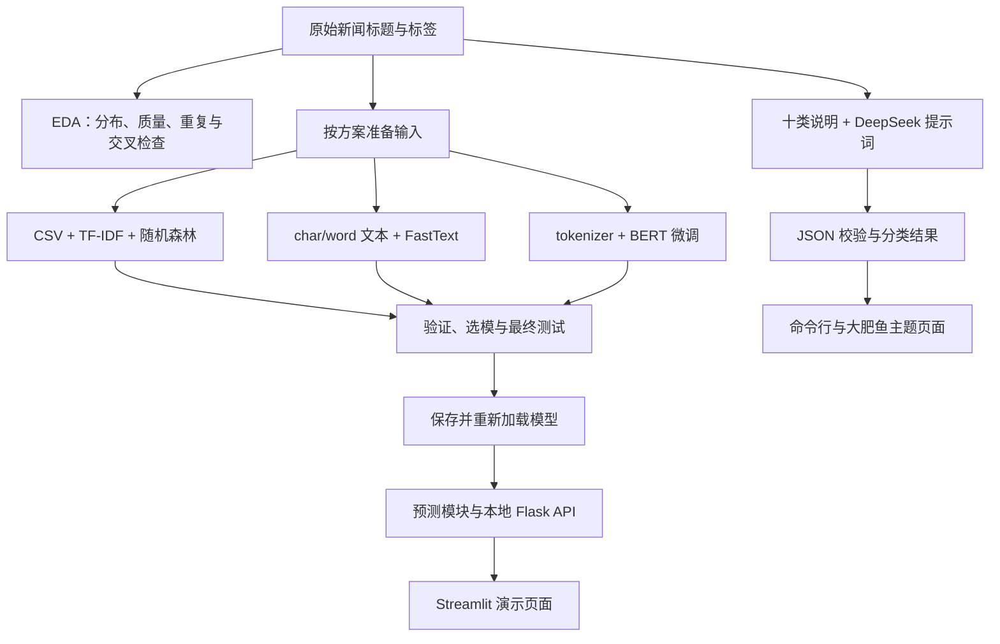
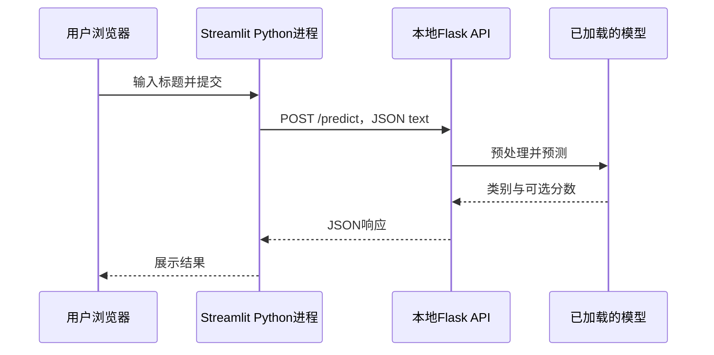

# 投满分项目：中文新闻分类完整教程

用同一套中文新闻标题数据，依次学习数据处理、TF-IDF + 随机森林、FastText、BERT 微调、DeepSeek 提示词分类、BERT INT8 量化、知识蒸馏和剪枝，并把分类能力接到 HTTP 接口和网页。本教程面向第一次接触项目的使用者与希望逐步读懂代码的学习者。

当前版本 **v0.4.0**：新增蒸馏与剪枝实验源码。新阶段的准备步骤、运行入口和验证范围见 [发布说明](docs/releases/v0.4.0.md)。

<a id="quick-start"></a>
## 先跑起来：快速启动

**先选一条路线，不必把所有模型全部训练一遍。** 仓库提供源码、数据、分词器小文件和主题资源，不附带已训练模型、大型预训练权重或真实 API Key。

| 你现在有什么 | 选择哪条路线 | 需要本地训练吗 | 需要什么服务 |
| --- | --- | --- | --- |
| 有 DeepSeek API Key，想先看页面 | A：大肥鱼新闻分类页 | 不需要 | Streamlit + 外部 DeepSeek API |
| 有完整的 BERT best_model 文件夹 | B：BERT 预测页 | 不需要 | 本地 Flask + Streamlit |
| 没有 Key，也没有任何模型 | C：随机森林从数据到页面 | 需要，可先用小样本 | 本地训练，再启动 Flask + Streamlit |
| 已有 FastText 模型和配套预处理模式 | D：FastText 预测页 | 不需要 | 本地 Flask + Streamlit |

以下命令默认使用 **Windows PowerShell**。每个代码块按行执行。除非注明，先进入仓库根目录；`src` 文件夹都位于各阶段目录下，根目录没有统一的 `src/` 或 `requirements.txt`。

### 第一步：获取代码和准备 Python

```powershell
git clone https://github.com/fqxxzyw/toumanfen-news-classifier.git
cd toumanfen-news-classifier
```

已经有项目时，直接进入现有仓库，不必重复 clone。

首次创建环境：

```powershell
conda create -n toumanfen python=3.10 -y
conda activate toumanfen
```

已有 `toumanfen` 时只执行激活。新打开一个终端后也要重新激活。

```powershell
python --version
python -c "import sys; print(sys.executable)"
```

后者用于确认当前终端确实使用目标环境。PyCharm 也应选择同一个解释器。遇到 PowerShell 无法激活 Conda 时，可以先改用 Anaconda Prompt，或按 Conda 的终端初始化说明配置后重新打开终端。

### 路线 A：直接打开大肥鱼主题页面

从仓库根目录执行：

```powershell
cd 05_LLM
python -m pip install -r requirements.txt
python -m streamlit run src/app.py --server.address 127.0.0.1 --server.port 8502
```

浏览器打开 **http://127.0.0.1:8502**。在侧栏填写自己的 DeepSeek API Key，输入新闻标题，再点击“开始分类”。页面输入的密钥仅用于当前会话，不自动写入磁盘。

这条路线不需要下载 BERT，也不需要训练随机森林或 FastText。页面启动后不会自动调用模型，点击分类才向 DeepSeek 发送新闻。

如果希望命令行也能使用密钥，在 `05_LLM` 中创建本地配置：

```powershell
if (-not (Test-Path .env)) { Copy-Item .env.example .env }
```

使用编辑器打开 `.env`，在本机填写：

```dotenv
DEEPSEEK_API_KEY=填写你自己的DeepSeek密钥
DEEPSEEK_BASE_URL=https://api.deepseek.com
DEEPSEEK_MODEL=deepseek-flash
```

`.env` 不上传 Git；仓库里的 `.env.example` 保持密钥为空。不要把真实密钥写到代码、README、截图或聊天消息中。

命令行单条与交互模式：

```powershell
python src/deepseek_client.py --text "球队在总决赛中获得冠军"
python src/deepseek_client.py
```

交互模式中输入 `q`、`quit`、`exit` 或 `退出` 结束。输出包含 `category` 和 `reason`。无有效密钥、网络不通或账户额度不足时，按错误提示处理；本地页面能打开不等于外部 API 已经调用成功。

### 路线 B：已有 BERT 模型，直接预测

先将完整模型目录放到：

```text
04_bert/models/best_model/
├── config.json
├── model.safetensors          # 或与加载器兼容的权重文件
├── tokenizer.json
├── tokenizer_config.json
└── metadata.json
```

保留这个文件夹原有的全部分词器配套文件；不同保存版本可能还包含词表等文件。只复制约 390 MB 的权重文件不够。

终端 1，从仓库根目录执行：

```powershell
conda activate toumanfen
cd 04_bert
python -m pip install -r requirements.txt
python src/api.py
```

等待模型加载完成，出现 `Running on http://127.0.0.1:8000` 后，保持此终端运行。

终端 2，也从仓库根目录执行：

```powershell
conda activate toumanfen
cd 04_bert
python -m streamlit run src/app.py --server.address 127.0.0.1 --server.port 8501
```

打开 **http://127.0.0.1:8501**。页面显示“预测服务已连接”后，输入新闻并提交。已有完整微调模型时，不需要再提供原始 `pretrained/bert-base-chinese` 权重。

### 路线 C：没有 Key 和模型，先训练随机森林

从仓库根目录执行：

```powershell
cd 02_rf
python -m pip install -r requirements.txt
python src/02_data_process.py
```

先用小样本熟悉训练流程，结果存到独立目录，避免覆盖正式模型：

```powershell
python src/03_train.py --limit 2000 --trees 10 --trees-per-batch 5 --jobs 1 --output-dir models/smoke_test
```

这只是流程检查，不能作为正式模型成绩；小样本还应检查是否覆盖所有类别。该目录不会被默认 API 自动使用。

准备正式模型时执行：

```powershell
python src/03_train.py
python src/04_evaluate.py
```

默认训练会写入 `models/rf_model.pkl` 与 `models/tfidf_model.pkl`，如需保留旧版本，应提前备份或使用不同输出目录。

模型准备好后，两个终端均进入 `02_rf`，分别运行：

```powershell
python src/05_predict_api.py
```

```powershell
python -m streamlit run src/06_app.py --server.address 127.0.0.1 --server.port 8501
```

页面：**http://127.0.0.1:8501**；API：`http://127.0.0.1:8001/predict`。

### 路线 D：已有 FastText 模型，直接预测

默认 API 加载 `03_fasttext/models/fasttext_char_autotune.bin`，采用字符预处理。将对应文件放好，从仓库根目录进入 `03_fasttext`，安装该目录的依赖：

```powershell
cd 03_fasttext
python -m pip install -r requirements.txt
python src/api.py
```

另一个终端也进入 `03_fasttext`：

```powershell
python -m streamlit run src/app.py --server.address 127.0.0.1 --server.port 8501
```

页面使用 8501，API 使用 8000。如果只有词语模型，需要同时调整 API 的模型路径和 `mode='word'`，不能只改文件名。

### 启动后怎么判断成功

1. API 终端没有退出，并显示监听地址；模型加载完成前先等待。
2. 浏览器打开的是 Streamlit 页面地址，而不是把 `/predict` 当网页打开。
3. 提交一条新闻，页面出现类别；BERT/FastText 还可返回模型分数，DeepSeek 返回分类理由。
4. 关闭时在服务终端按 `Ctrl+C`。修改模型文件后，应重启加载模型的 API 进程。

随机森林、FastText、BERT 的页面默认都使用 8501，FastText 与 BERT API 都使用 8000。**一次选择一套本地方案运行。** 大肥鱼页面使用 8502，可与一套本地方案同时打开。只修改页面端口不能解决 API 端口冲突。

---

## 完整教程目录

1. [项目背景与任务定义](#background)
2. [学习路线、整体架构与数据流](#architecture)
3. [目录结构与文件职责](#layout)
4. [环境、依赖和路径约定](#environment)
5. [数据格式、标签与数据划分](#dataset)
6. [数据探索、清洗与预处理](#data-processing)
7. [TF-IDF 与随机森林：从特征到模型](#random-forest)
8. [FastText：字符、词语与自动调参](#fasttext)
9. [BERT：从分词、微调到最优模型](#bert)
10. [DeepSeek：提示词、客户端与主题页面](#llm)
11. [评估指标、结果比较与错误分析](#evaluation)
12. [HTTP API、Streamlit 与前后端调用](#services)
13. [模型文件、导出、分享与密钥管理](#artifacts)
14. [从零到完成的操作清单](#workflow)
15. [常见问题与分层排查](#troubleshooting)
16. [扩展方向与当前实现边界](#extensions)
17. [函数索引与阅读入口](#function-index)
18. [参考资料和文档分工](#references)

<a id="background"></a>
## 1. 项目背景与任务定义

### 1.1 为什么做新闻分类

新闻平台需要把新内容放入体育、财经、教育等频道。人工逐条整理成本高，关键词规则又容易漏掉不同表达。分类模型根据有标签的历史样本学习规律，对新的标题输出统一类别，便于内容检索、频道分发、数据统计和后续业务处理。

本项目把这个问题拆成可以逐步学习的工程流程：先读懂数据，再建立简单基线，随后比较轻量神经网络、预训练模型和大模型提示词方案，最后封装成能被页面调用的分类能力。

### 1.2 输入和输出是什么

输入是一条中文新闻标题或简短资讯，例如：

```text
中国队在总决赛中战胜对手，成功夺得冠军
```

输出是十类中的一个，例如 `sports`。这只是说明业务含义的示例，具体预测以实际模型为准。

任务属于**有监督、单标签、十分类的中文短文本分类**：

- 有监督：本地模型的训练样本同时包含文本与类别。
- 单标签：每条新闻选择一个主要类别，而不是同时选择多个独立标签。
- 十分类：类别集合固定，不能让预测阶段随意添加第十一类。
- 短文本：数据主要是标题。长篇全文的截断、摘要和多主题处理需要额外设计。

DeepSeek 阶段直接调用已有模型做提示词分类，不在本项目数据上训练一个新大模型。

### 1.3 分类、解释和推荐分别解决什么

分类回答“新闻属于哪类”；分类理由解释模型为何给出该结果；推荐还要考虑用户、候选集合、时间和排序规则。类别可以成为推荐系统的一项内容特征，但本仓库没有用户画像数据库、个性化召回和推荐排序服务。

同样，`score` 或 `probability` 是对应模型的类别分数，不是用户会点击的概率，也不等于这条预测一定正确的概率。LLM 生成的理由也不能替代真实标签与评估。

<a id="architecture"></a>
## 2. 学习路线、整体架构与数据流

### 2.1 为什么保留四种分类方案

| 方案 | 文本怎样变成特征 | 主要学习内容 | 使用时依赖 |
| --- | --- | --- | --- |
| TF-IDF + 随机森林 | 分词后统计词项权重，输入树模型 | 数据清洗、稀疏特征、传统监督学习 | 配套向量器和随机森林 |
| FastText | 按字符或词语切分，由监督模型学习文本表示 | 轻量文本分类、预处理对齐、自动调参 | 对应 .bin 模型与预处理模式 |
| BERT | 配套 tokenizer 编码，预训练编码器与分类头联合微调 | 张量、设备、训练循环、验证和模型保存 | 完整微调目录与 PyTorch |
| DeepSeek | 指定类别与输出格式，通过远程模型生成结果 | 提示词、结构化输出、网络客户端和错误处理 | 网络、有效 Key 与账户额度 |

编号表示建议学习顺序，不表示 `05_LLM` 必须先调用 `04_bert`。这些方案可以独立运行，也可在相同数据与评估约定下进行比较。

### 2.2 项目完整链路



### 2.3 训练与预测的区别

训练读取带标签的数据并更新参数；预测读取已保存的参数，对新文本输出类别。正常页面请求只执行预测，不应重新运行训练脚本。

传统方案需要在训练阶段 `fit` 特征工具；预测阶段只 `transform`。BERT 推理需要 `eval()` 与关闭梯度记录；DeepSeek 预测需要请求远程服务，不会在当前电脑保存一份训练好的 DeepSeek 权重。

<a id="layout"></a>
## 3. 目录结构与文件职责

```text
toumanfen-news-classifier/
├── README.md                     # 本项目总教程
├── VERSION / CHANGELOG.md         # 版本号和变更历史
├── 01_data/
│   ├── data/                     # 原始 TXT、类别表、停用词和 CSV
│   └── src/
│       ├── 01_eda.py              # 探索性分析
│       └── 02_data_process.py     # 清洗、jieba 分词、CSV 导出
├── 02_rf/
│   ├── data/                     # 随机森林阶段的数据
│   ├── src/
│   │   ├── 01_eda.py / 02_data_process.py
│   │   ├── 03_train.py / training_utils.py
│   │   ├── 04_evaluate.py / prediction.py
│   │   ├── 05_predict_api.py / 06_app.py
│   │   └── config.py
│   ├── models/                   # 本地生成或自行复制，不在源码包中
│   └── artifacts/                # EDA 与评估产物
├── 03_fasttext/
│   ├── data/raw/                 # train/dev/test/class 原始 TXT
│   ├── data/processed/           # 六份 char/word 格式文件
│   ├── src/                      # config、preprocess、train、evaluate、predictor、api、app
│   └── models/                   # 本地 .bin 模型
├── 04_bert/
│   ├── data/                     # 原始标题与数字标签
│   ├── pretrained/bert-base-chinese/
│   │                             # 分词器/配置 + 需要另备的大型预训练权重
│   ├── src/                      # config、data、train、metrics、test_model、predictor、api、app
│   ├── tests/test_web.py
│   └── models/best_model/        # 完整微调模型，不在源码包中
├── 05_LLM/
│   ├── data/                     # 后续对照评估可用的标题数据
│   ├── src/                      # config、prompts、deepseek_client、app
│   ├── assets/                   # 本地鲸鱼娘插画、CSS、生成说明
│   ├── tests/test_deepseek.py
│   ├── .streamlit/config.toml    # 页面配色
│   ├── .env.example              # 可提交的空值配置样例
│   ├── .env                      # 用户本地密钥，Git 忽略
│   └── outputs/                  # --save 生成的 JSONL
├── 06_model_quantization/
│   ├── data/test.txt             # 同一十分类测试数据
│   ├── src/                      # 量化、数据加载、质量评估、大小与延迟比较
│   ├── tests/                    # 数据、指标与计时的回归检查
│   └── models/                   # 本地 FP32 和 INT8 权重，不上传
├── 07_model_distillation/
│   ├── data/                     # train/dev/test/class 原始数据
│   ├── src/                      # Teacher 缓存、BiLSTM Student、蒸馏训练与预测
│   ├── cache/                    # 本地 Teacher 缓存，不上传
│   └── models/                   # 本地 Teacher 和 Student 权重，不上传
├── 08_model_prune/
│   ├── data/                     # train/dev/test/class 原始数据
│   ├── src/                      # Query 剪枝、恢复训练、评估与预测
│   ├── outputs/                  # 本地运行输出，不上传
│   └── models/                   # 本地原始和剪枝模型，不上传
└── docs/
    ├── VALIDATION.md             # 实际检查的范围和证据
    ├── progress/                 # 按日期保存进度
    └── releases/                 # 固定版本发布说明
```

目录图同时包含源码文件和运行后生成的目录；刚克隆时没有 `models/` 属于正常情况。各阶段有独立的配置与数据路径，不会因为在 `01_data` 生成 CSV，就自动更新 `02_rf/data`。

<a id="environment"></a>
## 4. 环境、依赖和路径约定

### 4.1 每个阶段安装自己的依赖

| 阶段 | 安装位置 | 主要依赖 |
| --- | --- | --- |
| 数据分析 | 仓库根目录执行 `python -m pip install -r 02_rf/requirements.txt` | pandas、NumPy、jieba、matplotlib、seaborn |
| 随机森林 | `02_rf` | 上述数据工具、scikit-learn、Flask、Streamlit |
| FastText | `03_fasttext` | fasttext-wheel、jieba、scikit-learn、Flask、Streamlit |
| BERT | `04_bert` | torch、transformers、NumPy、scikit-learn、tqdm、Flask、Streamlit |
| DeepSeek | `05_LLM` | OpenAI 兼容 SDK、python-dotenv、tenacity、Streamlit |

`python -m pip` 跟随当前 Python 安装依赖，减少 pip 与运行解释器不一致的问题。依赖文件不是一份精确锁定的完整环境，不保证任意平台安装后得到完全相同版本。需要复现实验时应同时记录 Python、依赖、设备、数据和模型版本。

BERT 自动选择可用 CUDA，否则使用 CPU。仅安装能导入的 PyTorch 不代表已有 GPU 支持；GPU 版安装方式应按本机驱动和 [PyTorch 官方安装说明](https://pytorch.org/get-started/locally/) 选择。先确认基本流程，再决定是否全量训练。

### 4.2 工作目录和脚本位置分别是什么

终端当前目录决定 `python src/train.py` 到哪里找文件；代码里的 `__file__` 则指向脚本自身。大部分配置通过 `Path(__file__).resolve()` 定位阶段目录，因此数据路径不依赖终端位置，但启动命令仍要写对。

例如：

```text
当前目录是 04_bert       → python src/train.py
当前目录是 04_bert/src   → python train.py
当前目录是仓库根目录      → python 04_bert/src/train.py
```

FastText 还有原生库路径限制：代码用 `os.path.relpath` 把传入原生接口的路径转为相对路径。在当前 Windows 环境中，请从仓库根目录、`03_fasttext` 或其 `src` 运行，避免相对路径仍含中文目录名。不要据此认为项目内所有 Python 文件都不能放在中文路径。

### 4.3 在 PyCharm 中运行

1. 打开整个仓库，选择 `toumanfen` 对应的解释器。
2. 普通入口，如 `03_train.py`、`train.py`、`deepseek_client.py`，可以直接运行。
3. 参数写到运行配置的参数栏，例如随机森林 `--limit 2000 --trees 10`。
4. Streamlit 使用终端中的 `python -m streamlit run ...`，或配置运行模块 `streamlit`，参数为 `run src/app.py`。
5. 多个阶段都有名为 `config.py` 的模块，分别从阶段入口运行，不把不同阶段的 src 混合加入同一个导入环境。

### 4.4 哪些命令可能耗时或覆盖文件

| 操作 | 影响 |
| --- | --- |
| 数据清洗 | 覆盖当前阶段的 train/dev/test CSV |
| FastText 预处理 | 覆盖六个 char/word 文件 |
| 随机森林默认训练 | 覆盖配套 RF 与 TF-IDF 文件 |
| FastText 默认训练 | 运行两个基础模型与两次自动调参，覆盖四个模型 |
| BERT 训练 | 更新配置中的 best_model 目录；当前没有非空目录保护 |
| LLM `--save` | 追加写 JSONL，不覆盖已有行 |
| 页面预测 | 不训练；LLM 会访问外部服务，可能产生 API 使用费用 |

已有可用模型时直接预测即可。重新实验需要保留旧模型时，先复制到其他目录，或在支持的位置修改输出路径。

<a id="dataset"></a>
## 5. 数据格式、标签与数据划分

### 5.1 数据来源和规模

原始数据是公开的 THUCNews 20 万条新闻标题子集，仓库保留上游的 train/dev/test 划分。它是已标注的标题样本，不是本项目重新抓取的新闻全文。

数据说明见 [01_data/data/README.md](01_data/data/README.md)；上游见 [Chinese-Text-Classification-Pytorch 的 THUCNews 数据目录](https://github.com/649453932/Chinese-Text-Classification-Pytorch/tree/master/THUCNews/data)。停用词表的具体上游授权尚未完整记录，不能仅因源码可下载就替所有资源额外声明许可。

| 文件 | 原始条数 | 目的 |
| --- | ---: | --- |
| train.txt | 180,000 | 学习参数或建立训练特征 |
| dev.txt | 10,000 | 调参、比较方案、早停与选模 |
| test.txt | 10,000 | 开发结束后报告最终泛化表现 |
| class.txt | 10 行 | 数字标签与类别名称的固定对应关系 |

清洗后的 CSV 可能因删除异常样本而减少，报告指标时应记录实际样本数。

### 5.2 原始 TXT 契约

UTF-8，无表头，每条记录是：

```text
新闻标题<Tab>数字标签
```

`<Tab>` 表示一个真实制表符，不是普通空格，也不是文件中要写入的五个字符。用 Python 生成一行时可以写 `"球队夺冠\t7\n"`。

不要在标题中插入未转义的 Tab 或换行；FastText 的原始读取按 Tab 拆字段，BERT 也按第一处 Tab 拆分文本和标签。扩展数据前应检查这种格式约定。

### 5.3 十个类别的固定编号

| ID | 英文标签 | 中文 | 常见主题 |
| --- | --- | --- | --- |
| 0 | finance | 财经 | 银行、保险、利率、宏观金融 |
| 1 | realty | 房产 | 楼盘、住房、土地、房价 |
| 2 | stocks | 股票 | 股指、证券、上市公司行情 |
| 3 | education | 教育 | 学校、考试、招生、教育政策 |
| 4 | science | 科技 | 互联网、软件、硬件、科研、航天 |
| 5 | society | 社会 | 社会事件、民生、公共安全 |
| 6 | politics | 时政 | 政府政策、外交、国际政治 |
| 7 | sports | 体育 | 比赛、球队、运动员 |
| 8 | game | 游戏 | 电子游戏、网游、电竞产品 |
| 9 | entertainment | 娱乐 | 明星、影视、音乐、综艺 |

第一行是 0，不是 1。只调整 `class.txt` 的顺序却保留旧模型，会把数字预测映射到错误名称。增加类别时还要调整标签校验、模型输出维度、提示词和页面映射，并重新训练或重新验证。

### 5.4 各方案使用不同输入格式

| 方案 | 输入到模型之前的格式 | 示例或说明 |
| --- | --- | --- |
| RF | CSV 的 words 列，经 TF-IDF 转为稀疏矩阵 | `球队 在 比赛 中 夺冠` |
| FastText | 行首标签 + 空格分隔字符或词 | `__label__sports 球 队 夺 冠` |
| BERT | tokenizer 输出的张量字典 | input_ids、attention_mask、可能的 token_type_ids、labels |
| DeepSeek | 系统提示词 + 编码后的新闻标题 | 明确十类和 JSON 输出契约 |

不要把 RF 的停用词过滤或 jieba 分词结果直接作为 BERT 必需输入。BERT 需要配套 tokenizer，LLM 当前直接接收原始标题字符串。

### 5.5 划分数据时要守住什么边界

训练集更新参数；dev 帮助挑选参数和模型；test 留到最终评估。不能根据 test 上哪个结果好反复调参，再把同一 test 分数说成未见数据表现。

本项目还有两个容易混淆的细节：

- RF 的 `03_train.py` 会把 train.csv 再按 80%/20% 分层划分。变量 `x_test`、`y_test` 是训练文件中的内部评估部分，不是磁盘上的 test.csv。
- FastText 自动调参读取 dev 文件，所以随后报告的 dev 成绩已经参与模型选择。它不能替代最终 test。

现有脚本没有统一的全模型测试集基准。比较 RF、FastText、BERT 与 LLM 时，需要先明确相同的数据版本、评价集合与类别集合。

<a id="data-processing"></a>
## 6. 数据探索、清洗与预处理

### 6.1 为什么先分析数据

如果标签错位、新闻重复泄漏到验证集，或大部分样本来自某一类，后续再复杂的模型也难以给出可靠结论。EDA 先回答“数据是什么样的、哪里可能有问题”，不是先追求漂亮图表。

从仓库根目录执行：

```powershell
python -m pip install -r 02_rf/requirements.txt
cd 01_data
python src/01_eda.py
```

主要产物：

```text
01_data/artifacts/eda/
├── eda_summary.json
├── label_distribution.png
└── text_length_distribution.png
```

### 6.2 EDA 的实际调用顺序

| 函数 | 做什么 | 为什么需要 |
| --- | --- | --- |
| load_classes | 读取类别，检查为空和重名 | 保证标签映射有效 |
| load_dataset | 读取 TXT，检查数字标签与范围 | 避免非法标签流入统计 |
| analyze_split | 各类数量、占比、空文本、重复、同文异标、疑似乱码、长度分位数 | 发现质量与分布问题 |
| check_split_overlap | 比较 train/dev/test 的文本交集 | 识别潜在评估泄漏 |
| draw_label_distribution | 训练集类别分布图 | 直观看不平衡 |
| draw_text_length_distribution | 字符长度直方图与 P95 | 帮助理解文本长度 |
| main | 串联分析，写 JSON 和图片 | 保证流程和输出可重复 |

“完全重复”是文本和标签都一样；“同文异标”是同一文本被标成不同类别；“跨集合交集”表示同一文本出现在不同集合。这些问题的处理策略不同，不应简单合并成一个去重开关。

字符长度也不等于 BERT 的 token 长度。根据 EDA 选长度后，还要检查实际分词结果；不能把 P95 字符数直接当成所有模型相同的截断参数。

### 6.3 清洗脚本做什么

在 `01_data` 中运行：

```powershell
python src/02_data_process.py
```

调用顺序：

```text
读取 TXT
→ 基础统计
→ 删除关键字段缺失与无效标签
→ 清洗文本
→ 过滤空文本
→ 可选去重
→ jieba 分词
→ 截取前 30 个词
→ 检查输出字段与合法值
→ 保存 CSV
```

`clean_text` 处理 HTML、换行/制表符、零宽字符、乱码替换符和连续空白；`cut_sentence` 过滤空词后用空格连接；`truncate_words` 按词数切片。`DROP_DUPLICATES=False` 表示当前默认不删除内部完全重复记录；脚本也不会自动解决跨集合重复和同文异标问题。

输出字段：

| 字段 | 含义 | 后续用途 |
| --- | --- | --- |
| text | 清洗后的完整标题 | 查看样本和错误分析 |
| label | 0～9 的整数标签 | 训练、评估 |
| words | 最多 30 个 jieba 词，用空格连接 | RF 的 TF-IDF 输入 |

被截断的是 `words` 中的词序列，不是把 `text` 强行改成前 30 个汉字。停用词过滤在 RF 的 TF-IDF 阶段进行，清洗脚本不会把所有停用词从 text/words 中删掉。

### 6.4 01_data 与 02_rf 如何衔接

两个阶段各有自己的 data 和脚本，输出不会自动同步。最直接的 RF 使用方式是在 `02_rf` 运行它自身的 `02_data_process.py`，生成 `02_rf/data/*.csv`。

如果要复用 `01_data` 的处理结果，应明确复制目标或修改 RF 配置路径，并检查三个 CSV 与类别表是否配套。不要以为文件名相同就来自同一轮处理。

清洗规则发生变化时，还应同步线上预测的规则。当前 RF 在线模块主要执行 jieba 分词与前 30 个词截断，没有完整复用离线 clean_text；对包含 HTML、特殊空白的输入应检查训练/推理的一致性。

<a id="random-forest"></a>
## 7. TF-IDF 与随机森林：从特征到模型

### 7.1 为什么不能直接把中文字符串交给随机森林

随机森林需要数值特征。这里先把新闻分成词，再让 TF-IDF 把每条标题转换成“各词项权重组成的向量”。不同标题共用同一词表维度，森林才能根据这些数值划分样本。

TF 是词在当前文档中的出现频次；IDF 降低几乎每条文本都出现的词的权重。scikit-learn 默认平滑 IDF 可写为：

```text
idf(t) = log((1 + N) / (1 + df(t))) + 1
```

其中 N 是训练文档数，df(t) 是包含词 t 的文档数，乘以词频后还会按默认设置归一化。实现细节见 [scikit-learn 特征提取文档](https://scikit-learn.org/stable/modules/feature_extraction.html#tf-idf-term-weighting)。

### 7.2 训练入口逐步做什么

在 `02_rf` 执行 `python src/03_train.py`：

1. `Config()` 定位 train.csv、停用词与模型保存路径。
2. 读取 `words`、`label`，把缺失分词结果填为空字符串。
3. 读取停用词，以空白拆分、去重，得到稳定列表。
4. 先划分原始分词文本，再在训练部分 `fit_transform` TF-IDF。
5. 内部评估文本只执行 `transform`，不重新学习词表与 IDF。
6. 使用 `train_forest` 逐批增加树，展示训练进度。
7. 使用 `predict_batches` 分批预测内部评估部分，打印指标。
8. 配套保存随机森林与 TF-IDF 向量器。

关键 TF-IDF 配置：

| 配置 | 当前值 | 原因 |
| --- | --- | --- |
| tokenizer | str.split | words 已分好词，不再次用默认规则切分 |
| token_pattern | None | 与自定义 tokenizer 配合，保留单字词 |
| lowercase | False | 避免额外修改大小写，与当前停用词规则一致 |
| dtype | np.float32 | 减少特征数值存储开销 |
| stop_words | 读取的词表 | 训练和推理由保存的同一向量器处理 |

### 7.3 稀疏矩阵与内存

假设有 180,000 条标题、100,000 个词项，每条标题实际只用很少的词。大部分特征是零，因此 TF-IDF 使用稀疏表示，而不是保存全部零。

不要为了打印或传参，对整个矩阵直接调用 `toarray()`。按上面规模，单是 float32 稠密数值约需 72 GB 十进制内存，尚未计入其他对象。查看特征时先切几行、几列，再转成小数组。

`train_forest` 将训练特征转 CSC 并排序索引，供森林训练使用；它不是把每批数据分别当成独立的数据集。

### 7.4 分批增加树不等于增量学习新样本

森林使用 `warm_start=True`。假设总树数为 100，每批增加 5 棵，那么训练按 5、10、15……100 棵推进；旧树保留，新树仍在同一训练特征上学习。

这主要用于控制进度反馈与训练组织，不是对新数据调用 `partial_fit`，也不是每批 5 棵训练在不同数据切片上。

### 7.5 可用参数与小样本检查

```powershell
python src/03_train.py --help
python src/03_train.py --limit 2000 --trees 10 --trees-per-batch 5 --jobs 1 --predict-batch-size 500 --output-dir models/smoke_test
```

| 参数 | 默认 | 作用 |
| --- | ---: | --- |
| --limit | 全部 | 只读取 CSV 前若干行，不是随机抽样 |
| --trees | 100 | 森林总树数 |
| --trees-per-batch | 5 | 每批新增树数 |
| --jobs | 2 | 森林并行任务数，仅接受正整数 |
| --predict-batch-size | 2000 | 分批预测的样本数 |
| --output-dir | models | 该次训练的配套模型输出目录 |

数据按 label 分层划分，随机种子为 42。如果前若干行中某类只有一个样本，或样本量太小，分层划分可能失败；扩大样本并检查类别数量。`--output-dir` 只影响这次训练，默认评估和 API 不会自动切换去读它。

### 7.6 独立 dev 评估

```powershell
python src/04_evaluate.py
```

这个脚本加载默认路径下的两个模型，读取 dev.csv，只执行已保存 TF-IDF 的 `transform`，预测后生成：

```text
02_rf/artifacts/evaluation/
├── dev_predictions.csv       # 原数据 + pred，便于逐条核对
└── dev_metrics.json          # 集合、样本数、accuracy、宏平均 P/R/F1
```

当前 RF 独立评估脚本固定读取 dev，不是 test。即使 Config 定义了 test_path，也不代表已经实现了独立 test 入口。

### 7.7 预测、接口与模型配套

`prediction.py` 在导入时加载 `rf_model.pkl` 和 `tfidf_model.pkl`。`predict_fun` 接收含 text 的字典，执行分词、30 词截断、transform、predict，再按 class.txt 映射类别。

配套关系必须保留：**词表/IDF、森林、类别顺序与训练时的预处理**。重新拟合一个 TF-IDF 却保留旧森林，可能维度报错，也可能得到没有意义的特征解释。

`05_predict_api.py` 包装成 Flask POST 接口；`06_app.py` 调用接口，并将英文标签显示为中文。详细的 RF 函数教程见 [02_rf/README.md](02_rf/README.md)，其中出现的“项目根目录”应结合其阶段语境理解为 `02_rf`。

<a id="fasttext"></a>
## 8. FastText：字符、词语与自动调参

### 8.1 本阶段在学什么

FastText 监督分类直接从切分后的文本学习表示并预测标签，省去手工建立 TF-IDF 再训练森林的分离步骤。本项目重点比较“按字符”和“按词语”两种输入，以及基础训练和自动调参的差异。底层工具使用方式可参考 [FastText 官方监督分类教程](https://fasttext.cc/docs/en/supervised-tutorial.html)。

本仓库不是先训练一个无监督词向量文件再导入分类器；这里直接调用 `train_supervised`。

### 8.2 原始数据怎样变成 FastText 格式

在 `03_fasttext` 中：

```powershell
python src/preprocess.py
```

`load_label` 按 class.txt 建立 ID 到英文类别的字典。`preprocess_text` 根据 mode 选择：

```text
原句：球队获得冠军
char：球 队 获 得 冠 军
word：按 jieba 的实际分词结果，用空格连接
```

`build_fasttest_data` 读取标题与数字标签，先把数字映射为英文类别，再写入：

```text
__label__sports 球 队 获 得 冠 军
```

函数名中的 `fasttest` 是当前代码名称，虽然拼写不标准，导入时仍要与实际定义一致。输出用 w 模式覆盖，避免重复运行产生数据累加。

最终生成：

```text
03_fasttext/data/processed/
├── train_char.txt
├── dev_char.txt
├── test_char.txt
├── train_word.txt
├── dev_word.txt
└── test_word.txt
```

每一套都包含同样的标签语义，但文本切分不同。训练和预测必须使用同一种 mode。

### 8.3 默认训练会运行四个实验

```powershell
python src/train.py
```

| 顺序 | 入口 | 输入 | 模型产物 |
| --- | --- | --- | --- |
| 1 | train_char | train_char.txt | fasttext_char.bin |
| 2 | train_word | train_word.txt | fasttext_word.bin |
| 3 | auto_param_tuning(char, 300) | train_char + dev_char | fasttext_char_autotune.bin |
| 4 | auto_param_tuning(word, 300) | train_word + dev_word | fasttext_word_autotune.bin |

`auto_param_tuning` 函数自身默认 duration 为 60 秒，但文件主入口明确传入 300 秒。这个预算是参数搜索时间，不是整个 train.py 的总耗时上限，还涉及数据读取、基础训练、最终模型训练和保存。

基础训练只传入输入路径，其余参数使用当前 fastText 默认值。不要把其他教程中的 dim、epoch、wordNgrams 数值当作本项目已经显式配置的值。

### 8.4 自动调参怎样使用验证集

代码使用 `autotuneValidationFile` 和 `autotuneDuration`。搜索不断比较 dev 上的表现，再选择参数；所以 dev 已经参与模型选择。

模型体积与运行内存取决于词表、桶数、向量维度等配置。不能只因为算法称为轻量分类器，就假定每个调参模型都很小。本地默认字符调参模型加载需要较多内存，资源不足时先使用基础模型完成流程。

只想训练基础模型时，可在 `03_fasttext` 运行：

```powershell
python -c "import sys; sys.path.insert(0, 'src'); from train import train_char; train_char()"
```

之后如要使用基础模型演示，需在 API 中把默认的字符调参文件切换为 `fasttext_char.bin`，mode 仍为 char；若使用词语模型，两处都要相应调整。

### 8.5 评估和单条预测

```powershell
python src/evaluate.py
python src/predictor.py
```

评估脚本按四模型顺序加载对应的 dev 文件，批量做 Top-1 预测，打印准确率与分类报告。默认需要四个模型都存在；只训练了一个模型时，可在脚本中保留对应组合，或从 Python 调用 `evaluate_model`。

`FastTextPredictor.predict(text)` 复用 `preprocess_text`，以列表形式调用批量 predict，再提取第一条结果，返回：

```json
{"label": "sports", "probability": 0.95}
```

示例分数仅用于展示响应格式。代码使用列表批量接口，是为了避开当前 fastText 与 NumPy 2 的单条预测兼容问题；调用时不要随意改回另一套返回值假设。

### 8.6 这一阶段的验收标准

- 六个输入文件行首都有正确的 `__label__`，不把数字标签和英文标签混用。
- 训练确实接收 `train_supervised` 返回的 model，并调用该实例保存。
- 评估文件、预测预处理 mode 和模型来源一致。
- API 在启动时加载一次模型，页面请求只做推理。
- 结果标明 dev 或 test，不把调参验证成绩当最终测试成绩。

详细入口见 [03_fasttext/README.md](03_fasttext/README.md)。

<a id="bert"></a>
## 9. BERT：从分词、微调到最优模型

### 9.1 先分清两个模型目录

| 路径 | 角色 | 哪些操作需要 |
| --- | --- | --- |
| pretrained/bert-base-chinese | 原始预训练配置、tokenizer 与权重 | 从头开始当前任务的微调 |
| models/best_model | 微调后的完整分类模型及辅助文件 | 独立测试、预测、API、页面 |

准备训练时，需要自行把与配置匹配的 PyTorch 权重放入预训练目录。Git 中的小型 config、tokenizer、vocab 文件不等于已经有了 BERT 权重。

只有 best_model 也能完成推理；只有原始 BERT 则还没有本任务训练好的分类头，不能把随机初始化的分类头预测当成已训练模型结果。

### 9.2 为什么使用配套 tokenizer

BERT 接收词元 ID，而不是直接接收中文字符串。tokenizer 负责词元划分、映射 ID、添加特殊词元、截断与补齐。训练与推理应加载同一套 tokenizer，以保持词表和输入处理一致。

本项目不先调用 jieba。`max_length=64` 指分词后的最大词元长度，包含特殊词元，不能简单解释成 64 个汉字。Transformer 文本分类的通用调用方式见 [Hugging Face 官方教程](https://huggingface.co/docs/transformers/en/tasks/sequence_classification)。

### 9.3 Dataset、DataLoader 和 collate_fn 的分工

```text
load_news_data：[(文本, 标签ID), ...]
         ↓
NewDataSet：按下标返回单条样本
         ↓
DataLoader：按 batch_size 取一批
         ↓
collate_fn：批量分词、补齐、生成 labels
         ↓
模型输入字典
```

`NewDataSet.__len__` 返回样本数，`__getitem__` 返回一条文本和标签。分词放在批处理函数里，便于对这一批动态补齐。

`build_context_fn` 返回内部函数，而不是立刻执行它；这个函数保留外层 tokenizer 和 max_length，供 DataLoader 每批调用。

当前常见张量：

| 字段 | 形状 | 含义 |
| --- | --- | --- |
| input_ids | [B, L] | 每个位置的词元 ID |
| attention_mask | [B, L] | 有效词元与 padding 的掩码 |
| token_type_ids | [B, L]，如果 tokenizer 提供 | 句段标识 |
| labels | [B]，torch.long | 每条样本的真实类别 ID |
| logits | [B, 10] | 模型输出的十类原始分数 |

B 是当前批次样本数，L 是该批补齐后的长度，L 不一定等于 64。最后一批也可以小于默认 batch_size。

### 9.4 DataLoader 的参数不要传错

真实签名为：

```python
build_dataloader(file_path, tokenizer, shuffle, max_samples=None, config=None)
```

正确示例：

```python
loader = build_dataloader(
    config.test_path, tokenizer, shuffle=False, config=config
)
```

第一项是文件路径，第三项是是否打乱，不是 batch_size。Config 通过命名参数传入，batch_size、max_length、num_workers 等从配置读取。把整个 Config 当作 file_path，最后会在 open() 时报路径类型错误。

`max_samples` 是数据工具可选能力，不代表 train.py 已经提供同名命令行参数。

### 9.5 训练配置

在 `04_bert/src/config.py` 修改：

| 字段 | 默认 | 解释 |
| --- | ---: | --- |
| batch_size | 16 | 每次参数更新所用样本批次大小 |
| max_length | 64 | tokenizer 长度上限 |
| num_epochs | 5 | 最多遍历训练集的轮数 |
| learning_rate | 2e-5 | AdamW 学习率 |
| weight_decay | 0.01 | 当前优化器使用的权重衰减 |
| warmup_ratio | 0.1 | 预热更新步数占计划总步数的比例 |
| patience | 2 | 连续未提升的允许轮数 |
| max_grad_norm | 1.0 | 梯度范数上限 |
| seed | 42 | 随机种子 |
| num_workers | 0 | Windows 下便于调试的加载进程设置 |

这里使用手写 PyTorch 训练循环，没有使用 Transformers Trainer。当前 `train.py` 不解析 `--epochs`、`--device`、`--output-dir` 等命令行参数。

### 9.6 模型初始化与类别映射

类别数由 `len(class_list)` 获取。`id2label` 是整数到名称，`label2id` 是名称到整数，两者方向不能写反。

`AutoModelForSequenceClassification.from_pretrained(...)` 根据配置选择架构并加载文本分类模型；原始检查点缺少分类头时，新初始化分类头属于预期情况，随后需要训练。若本来应该加载同一份完整微调模型却出现大量 missing/unexpected，先检查模型类与目录是否选对。

固定种子后，模型与 batch 都要移到同一 device。`batch.to` 的转换只移动输入，不会自动把模型一并移动。

### 9.7 一次训练更新究竟发生什么

核心顺序：

```python
optimizer.zero_grad()
outputs = model(**batch)
loss = outputs.loss
loss.backward()
torch.nn.utils.clip_grad_norm_(model.parameters(), config.max_grad_norm)
optimizer.step()
scheduler.step()
```

- 清零：PyTorch 默认累加梯度，当前流程每批独立更新，需要清除上一批梯度。
- 前向传播：`**batch` 把字段作为关键字参数传入。含 labels 时模型计算分类损失。
- 反向传播：`loss.backward()` 计算参数梯度，这一步尚未更新权重。
- 梯度裁剪：在反向传播后、参数更新前限制梯度整体范数。
- 优化器更新：用当前梯度与学习率更新参数。
- 调度器更新：准备下一步的学习率。

不要把 `loss = model.backward()` 当作前向损失获取；反向传播应作用于标量 loss。

`model.train()` 控制 Dropout 等层的训练行为，并不自动执行上述步骤。一个 epoch 是完整遍历一次训练数据；一个 step 通常是处理一批并更新一次参数。

### 9.8 学习率预热与训练损失

计划总步数为 `len(train_dataloader) * num_epochs`；预热步数取其 warmup_ratio 比例并向下取整。学习率先逐渐升高，再线性下降。提前停止时实际更新次数会少于计划值。

当前展示的 train_avg_loss 是各批损失的算术平均；如果最后一批较小，它不是严格按每条样本加权的平均损失。它用于观察训练趋势，不要与别的脚本的加权平均 loss 不加区分地比较。

### 9.9 验证、最优模型与早停

每轮训练结束后：

1. `model.eval()` 切到评估行为。
2. `torch.no_grad()` 关闭梯度记录。
3. 汇总整个 dev 的真实与预测标签，再统一计算指标。
4. 取宏平均 F1，与历史最好结果比较。
5. 严格提升才保存；否则未提升计数加一。

循环外初始化：

```python
best_f1 = float('-inf')
no_improvement_count = 0
```

Python 不需要先声明类型，但读取前必须赋值。初始化放在 epoch 循环外，才能记住上一轮结果。F1 严格大于才算提升，相等也计入未提升。

例如 patience=2 时，连续两轮都没超过历史最好 F1，就结束训练；任何一次提升都会清零计数。下一轮开始要重新 `model.train()`，因为验证已经切换模式。

### 9.10 保存了什么，没保存什么

最优 F1 提升时保存：完整模型权重与 config、tokenizer，以及 metadata.json，其中记录 class_list、max_length、best_f1 和来源路径。

当前元数据字段 `pretrained_mode` 是来源路径记录，名称保留现有实现；预测使用 best_model，不要求另一台电脑具有原来的绝对路径。

当前循环没有保存优化器、调度器和训练步数状态，不支持精确恢复原训练进程；也不会自动生成 history.json、best_metrics.json 或 training_args.json。目录里若已有这些文件，可能来自以前的代码，不能直接断言它们代表当前训练。

### 9.11 独立测试与单条预测

```powershell
python src/test_model.py
python src/predictor.py
```

测试入口加载 best_model，读取 test.txt，并共用 evaluate。后者返回 `(acc, precision, recall, f1, report)`，所以不能写成字符串键访问。

单条预测步骤：去掉首尾空白 → tokenizer 编码 → 输入移到设备 → eval/no_grad 前向传播 → softmax → 取最大项 → 映射类别。

```python
prob = torch.softmax(logits, dim=1)
score, pred = torch.max(prob, dim=1)
pred_id = pred.item()
score_value = score.item()
```

对于一条文本，logits 为 [1,10]，max 后为两个 [1] 张量。`argmax` 只返回位置，不能同时解包出分数；`.item()` 将单元素张量变成普通数值。

只比较最大类别不一定要先 softmax，但要显示类别概率时需要把原始 logits 转换。已有推理实例可以反复调用 `predict_one`，不必每条新闻重新加载模型。

完整阶段说明见 [04_bert/README.md](04_bert/README.md)。

<a id="llm"></a>
## 10. DeepSeek：提示词、客户端与主题页面

### 10.1 本方案与本地训练的关系

`05_LLM` 用已有 DeepSeek 模型做新闻十分类，每次请求独立处理一条新闻，不拼接历史聊天。配置虽保留 train/dev/test 路径，当前客户端不会自动读取它们训练模型，也没有实现全数据集 LLM 评估。

“大肥鱼”是页面的鲸鱼娘主题，业务输出仍是新闻分类。插画和 CSS 属于本地页面资源，不会作为新闻内容发送给 API。SDK 使用 OpenAI 兼容格式，但请求目标是配置的 DeepSeek 地址，需要 DeepSeek 的密钥。

### 10.2 提示词怎样限定任务

`prompts.py` 包含：

- CATEGORY_DESCRIPTIONS：十类的业务说明，尤其区分财经、股票等相近主题。
- CATEGORY_TEXT：将类别字典转换成提示词中的列表。
- SYSTEM_PROMPT：指定标题是待处理数据，要求单个合法类别与 JSON 输出。
- USER_PROMPT：把标题作为 JSON 字符串放入消息。

标题通过 `json.dumps(..., ensure_ascii=False)` 编码，再填入模板。换行或引号不会直接破坏 JSON 字符串表示。但“把内容当数据”这一提示并不意味着模型不可能被标题中的指令影响，所以还需要本地校验与实际评估。

目标结构：

```json
{"category": "sports", "reason": "新闻的核心事件是体育比赛结果"}
```

### 10.3 配置从哪里读取

一般配置在 config.py：

| 字段 | 默认 | 说明 |
| --- | --- | --- |
| base_url | https://api.deepseek.com | 外部 API 地址 |
| model_name | deepseek-flash | 当前配置的模型 ID |
| max_tokens | 128 | 命令行默认输出预算，不是输入字符上限 |
| timeout | 30.0 秒 | SDK 请求超时配置 |
| output_dir | outputs | --save 的追加保存目录 |

本地连接设置优先级：系统环境变量覆盖 `.env.local`，后者覆盖 `.env`。构造客户端时显式传入的 api_key、model 又优先于对应的本地配置。页面侧栏通过显式参数使用本次会话的值，不把它写回文件。

可用环境字段为 DEEPSEEK_API_KEY、DEEPSEEK_BASE_URL、DEEPSEEK_MODEL。页面默认输出上限为 256，可选择 128/256/512/1024；命令行不指定其他实现时沿用 Config 的 128。

### 10.4 classify 的实际处理顺序

1. 校验标题是非空字符串，去掉首尾空白，限制不超过 5000 字符。
2. 检查密钥存在；没有密钥时在本地报错，不发送空凭据请求。
3. 第一次实际分类时创建 SDK 客户端。
4. 组合 system 与 user 消息，发送分类请求。
5. 使用 temperature=0、JSON object 输出，关闭当前接口的思考模式。
6. 处理超时、连接失败与 HTTP 状态错误。
7. 检查有 choices，且没有因长度上限被截断。
8. json.loads 解析，要求结果为对象。
9. category 必须是十类之一，reason 必须是非空字符串。
10. 返回标准化的 category、reason。

JSON 模式只帮助约束格式，并不能替代业务校验。具体格式要求见 [DeepSeek JSON Output 文档](https://api-docs.deepseek.com/guides/json_mode/)。模型 ID 与服务能力可能随提供方更新，连接失败时应结合服务方文档和账户可用模型核对，不能只盲目更换依赖。

### 10.5 重试和错误怎样处理

| 情况 | 当前行为 |
| --- | --- |
| 401 | 提示密钥无效 |
| 402 | 提示账户余额不足 |
| 403 | 提示没有调用权限 |
| 429 | 对限流有限重试，仍失败时提示稍后再试 |
| 服务器临时错误 | 有限重试 |
| 网络超时/连接失败 | 提示检查网络或 timeout |
| 非法 JSON、未知类别、空理由 | 拒绝结果，不当成有效分类保存 |
| finish_reason=length | 提示增大输出预算，不解析半截 JSON |

Tenacity 最多总计 3 次，每次重试间隔 1 秒，只匹配限流和服务器内部错误。SDK 内置自动重试被关闭，避免两层重试次数相乘。无效 Key、余额不足和解析失败不会被这层重试重复调用。

### 10.6 命令行调用和结果保存

在 `05_LLM` 中：

```powershell
# 查看参数
python src/deepseek_client.py --help

# 两种单条输入方式，二选一
python src/deepseek_client.py "某球队获得联赛冠军"
python src/deepseek_client.py --text "某球队获得联赛冠军"

# 连续输入标题
python src/deepseek_client.py

# 在单条或交互模式下追加保存结果
python src/deepseek_client.py --text "某球队获得联赛冠军" --save
```

位置参数 title 与 --text 不能同时使用。默认只打印 JSON；加 --save 后追加到 `outputs/predictions.jsonl`，每行是独立 JSON，包含 time、title、category、reason。JSONL 与一个装满记录的大 JSON 数组不同，读取时应逐行 json.loads。

### 10.7 前端怎样复用客户端

`app.py` 展示新闻输入、示例和结果，提交时调用 `DeepSeekClient.classify`，在 finally 中关闭连接。页面不需要再启动一个本地 Flask API。

每次提交先清除旧 prediction，成功后加入 records；发生错误时不会把旧结果冒充新结果。会话记录保留在 Streamlit 的 session_state 中，不自动写磁盘，刷新或断开会话可能丢失，需要保留时导出 JSON。

导出记录只含标题和结果，不含 Key、请求头或连接设置。“密钥已就绪”表示本地已有配置，不代表已经验证远程鉴权；实际点击后的返回才能确认请求是否成功。

详细说明见 [05_LLM/README.md](05_LLM/README.md) 与 [插画资源说明](05_LLM/assets/README.md)。

<a id="evaluation"></a>
## 11. 评估指标、结果比较与错误分析

### 11.1 Accuracy、Precision、Recall、F1

对某一个类别，把它看成正类，其他类别看成负类：

- TP：真实属于这一类，也预测为这一类。
- FP：真实不是这一类，却预测成了这一类。
- FN：真实属于这一类，却预测成其他类。

```text
Accuracy = 所有预测正确样本数 / 总样本数
Precision = TP / (TP + FP)
Recall = TP / (TP + FN)
F1 = 2 × Precision × Recall / (Precision + Recall)
```

Precision 关注“判成体育的新闻有多准”，Recall 关注“真正的体育新闻找到了多少”。F1 综合两者；只让模型一律猜多数类可能得到不低的 Accuracy，却让少数类别 Recall 很差。

### 11.2 多分类平均方式

| 方式 | 计算方法 | 阅读含义 |
| --- | --- | --- |
| macro | 逐类计算，再简单平均 | 每类同等重要，便于观察小类表现 |
| weighted | 逐类计算，按真实样本数量加权 | 大类对总值影响更大 |
| micro | 汇总所有类别计数后计算 | 单标签且覆盖全部类别时，P/R/F1 与总体 Accuracy 一致 |
| per-class | 单独列出每类指标 | 判断具体哪类容易漏判、误判 |

**宏平均 F1 是各类 F1 的平均，不是先求宏平均 P/R 再代入 F1 公式。** 分类报告中的 support 是该类真实样本数。

BERT 当前三个宏平均指标默认只纳入 y_true 或 y_pred 中出现的类别；分类报告则显式列出完整 class_list。小样本缺类时，报告里的 macro avg 与单独返回的 f1 可能不一样。跨实验比较应统一传入完整 labels 集合等计算口径，不能只看都叫“macro”。

当某类没有预测样本或真实样本时，分母可能为零。RF 指标明确使用 zero_division=0；BERT 顶层 P/R/F1 保留 sklearn 默认行为，可能发出告警并按默认规则填零，报告单独设置了 zero_division=0。告警应结合缺类情况理解，不等于训练过程自动崩溃。

### 11.3 如何正确比较四条路线

至少记录：模型/参数版本、数据来源、样本数、类别顺序、预处理、评价集合、指标口径、运行设备、单条或批量耗时。

已有 FastText 开发记录中的 dev 准确率示例：

| 模型 | dev 样本数 | Accuracy |
| --- | ---: | ---: |
| fasttext_char | 10,000 | 87.17% |
| fasttext_word | 10,000 | 89.90% |
| fasttext_char_autotune | 10,000 | 91.43% |
| fasttext_word_autotune | 10,000 | 91.55% |

这些是已有环境下的验证记录，不承诺不同环境重训得到相同结果。dev 参与调参，不是最终 test；没有统一完整 test 结果时，不据此给所有方案排最终名次。实际证据见 [验证记录](docs/VALIDATION.md)。

### 11.4 分数高不代表这个样本一定正确

FastText 的 probability、BERT 的 score 和 LLM 的 reason 不是同一种量：

- 概率分数受模型、训练数据和校准影响，高分也可能错。
- 同一输入的 0.95 不能直接跨模型解释成完全相同的可靠程度。
- LLM 的自然语言解释可能流畅却分类错误，仍要与人工标签对照。
- 页面演示成功只证明调用流程可用，不说明完整数据集效果。

### 11.5 怎么做错误分析

先保存“原文、真实标签、预测标签”，再按真实类别与预测类别分组。RF 已输出 dev_predictions.csv，便于筛选：

```python
import pandas as pd

predictions = pd.read_csv('02_rf/artifacts/evaluation/dev_predictions.csv')
errors = predictions[predictions['label'] != predictions['pred']]
print(errors[['text', 'label', 'pred']].head(20))
```

上例从仓库根目录运行。优先检查财经/股票、游戏/体育等相近类别、标题省略背景、截断后丢信息、标签本身有歧义、训练/预测预处理不同等情况。

调规则前先分类原因，再决定是修复数据、改变输入处理，还是调整模型。不要仅因某条预测错了就随意改 class.txt 顺序。

<a id="services"></a>
## 12. HTTP API、Streamlit 与前后端调用

### 12.1 四个页面不是同一个后端

| 方案 | API 入口 | API 默认地址 | 页面入口 | 是否需要本地 API |
| --- | --- | --- | --- | --- |
| RF | 02_rf/src/05_predict_api.py | 127.0.0.1:8001/predict | 02_rf/src/06_app.py，8501 | 是 |
| FastText | 03_fasttext/src/api.py | 8000/predict；当前绑定 0.0.0.0 | 03_fasttext/src/app.py，8501 | 是 |
| BERT | 04_bert/src/api.py | 127.0.0.1:8000/predict | 04_bert/src/app.py，8501 | 是 |
| DeepSeek | 本地没有独立 Flask API | 客户端请求外部 DeepSeek | 05_LLM/src/app.py，8502 | 否 |

FastText 的浏览器调用仍使用 127.0.0.1。`0.0.0.0` 是监听地址，不是建议用户输入的页面地址。端口改动需要同步调用方，不能只改启动参数。

### 12.2 为什么本地方案要开两个终端



Streamlit 既生成浏览器页面，也在 Python 进程里发出 requests 请求。关闭 API 终端后页面仍可能打开，但下一次分类会连接失败。

DeepSeek 页面则由 Streamlit 直接调用客户端，客户端向远程服务请求，不需要另开 src/api.py。

### 12.3 请求相似，但响应字段不同

本地三个 API 的合法请求都使用：

```json
{"text": "球队在总决赛中获得冠军"}
```

| 接口 | 成功响应示例 |
| --- | --- |
| RF | `{"result":{"text":"球队在总决赛中获得冠军","label":"sports"}}` |
| FastText | `{"label":"sports","probability":0.95}` |
| BERT | `{"pred":7,"class":"sports","score":0.95}` |
| DeepSeek Python 客户端 | `{"category":"sports","reason":"核心是体育比赛结果"}` |

数值和类别仅示意格式，实际以预测为准。换后端时必须修改页面解析逻辑；把 RF 的 `result.label` 直接用于 BERT 响应会取不到字段。

### 12.4 怎样从 Python 调用 BERT API

在 API 已启动后运行：

```python
import requests

response = requests.post(
    'http://127.0.0.1:8000/predict',
    json={'text': '球队在总决赛中获得冠军'},
    timeout=(3, 60),
)
response.raise_for_status()
print(response.json())
```

`json=` 会编码 JSON 并设置相应 Content-Type；`raise_for_status` 对错误状态抛异常；`timeout` 限制等待时间；`.json()` 把响应正文解析为 Python 对象。Python 字典参数和 HTTP 请求体是两个层次，不是把 Config 对象直接发给 open() 或接口。

### 12.5 健康检查和错误码

- RF 当前只有 POST /predict，没有 GET /health，直接访问首页也可能是 404。
- FastText GET /health 返回 status=OK，但输入类型、缺失 text 等异常校验尚不完整，不能把它当成与 BERT 同样完整的错误协议。
- BERT GET /health 返回模型设备、类别列表和最大词元长度；应用创建时模型已经加载，成功响应表示本地预测服务已就绪。
- DeepSeek 页面只在本地判断连接配置是否存在，真实远程权限和额度要以请求返回判断。

BERT 的状态处理：

| 状态 | 含义 |
| --- | --- |
| 200 | 合法请求，返回预测 |
| 400 | JSON 不是对象、text 缺失/非字符串/空白，或超过 5000 字符 |
| 404 / 405 | 路径或方法错误，返回 JSON 错误信息 |
| 413 | 请求体超过 64 KiB |
| 500 | 推理异常，详细原因写在 API 终端 |

BERT 使用锁让同一进程中的推理请求依次访问共享模型，避免同时推理造成内存突增。这不是完整的多进程调度或生产限流方案。

### 12.6 Streamlit 表单、状态和缓存

Streamlit 交互会触发脚本重跑，因此表单用于把输入和明确提交组合成一次操作；session_state 保留当前会话的结果。按钮回调用于填充示例，清除旧结果避免内容错配。

BERT 页面将短时服务健康查询缓存，模型本身仍只存在 API 进程，不会因为页面刷新就再加载一份 BERT。DeepSeek 页面只保留分类记录，不把真实 Key 混进导出数据。机制说明可参考 [Streamlit 表单文档](https://docs.streamlit.io/develop/concepts/architecture/forms)。

当前 FastText 页面保留较简单的演示实现，requests 没有显式超时；不要把其他阶段完善的错误处理误认为所有页面都已具备。

<a id="artifacts"></a>
## 13. 模型文件、导出、分享与密钥管理

### 13.1 每种模型该带哪些文件

| 方案 | 必须配套保留 | 不足够的做法 |
| --- | --- | --- |
| RF | rf_model.pkl、tfidf_model.pkl、类别顺序、预测代码和分词约定 | 只复制森林，不复制训练时的向量器 |
| FastText | 对应 .bin、正确的 char/word 预处理、预测代码 | 模型是 word，预测却按 char |
| BERT | 整个 best_model：权重、config、tokenizer、metadata | 只发一个 model.safetensors |
| DeepSeek | 代码、依赖、提示词、空值配置样例；使用者自行配置 Key | 直接把自己的密钥随项目分享 |

模型加载文件应来自可信的训练过程或可信来源；尤其 RF 的 pickle 加载会执行反序列化逻辑，不应随意打开来历不明的模型。

### 13.2 BERT 给同学时怎样组织

```text
分享目录/
├── src/
│   ├── config.py
│   ├── predictor.py
│   ├── api.py
│   └── app.py
├── requirements.txt
└── models/
    └── best_model/
        ├── model.safetensors
        ├── config.json
        ├── tokenizer.json
        ├── tokenizer_config.json
        ├── metadata.json
        └── 其他配套分词器文件
```

按原来的相对结构摆放后，Config 能自动定位模型。只做预测不需要 train/dev/test 数据，也不需要原始预训练权重。独立测试则还需要测试脚本、评估模块与测试数据。

### 13.3 哪些生成文件会被覆盖

模型目录、CSV、图表和预测记录含义不同。修改配置不会自动重新生成模型；替换权重也不会自动更新已启动进程中的内存对象。

建议每次正式实验保留数据版本、配置、指标和模型对应关系。若人为把旧 history.json 留在新权重目录，读取者可能误把旧成绩当新成绩；整理交付时应说明哪些文件由当前脚本生成。

### 13.4 `.env.example` 和 `.env` 的区别

`.env.example` 是可公开的字段说明，真实密钥为空；`.env` 是每台电脑私有的连接配置，由 Git 忽略。公开仓库包含样例不代表别人克隆后自动拥有 API 使用权限。

提交前可检查：

```powershell
git status --short
git ls-files '*env*'
git check-ignore -v 05_LLM/.env
```

正常发布跟踪的密钥配置文件应只有 `.env.example`。不要用 `git add -f` 强行提交 `.env`。如果某文件以前已经被跟踪，后来加入 gitignore 也不会自动从历史中消失；应单独处理跟踪与历史，并在发生泄露时更换密钥。

### 13.5 GitHub 源码包与本地模型

GitHub Release 的 Source code 来自版本标签中的已跟踪文件，不会包含电脑里所有同名文件夹。模型、密钥、缓存、IDE 配置和本地 `预习/` 都不作为源码交付内容。

获取最新教程可看 main；需要固定代码时可使用 [v0.4.0 Release](https://github.com/fqxxzyw/toumanfen-news-classifier/releases/tag/v0.4.0)。固定 commit 或标签中的 README 不会随着 main 修改而自动变化。

<a id="workflow"></a>
## 14. 从零到完成的操作清单

### 14.1 学习和开发的推荐顺序

| 步骤 | 你要完成什么 | 怎样验收 |
| --- | --- | --- |
| 1 | 明确十分类任务与标签映射 | 能解释一行标题数据、标签 ID 与类别名 |
| 2 | 完成 EDA | 能找到类别分布、长度、重复和跨集合检查结果 |
| 3 | 运行清洗 | 输出 text/label/words，标签有效，分词长度符合约定 |
| 4 | 建立 RF 基线 | 特征仅在训练部分拟合，能保存和重新加载模型 |
| 5 | 做独立 dev 评估 | 知道报告来自哪个集合，能查错分样本 |
| 6 | 封装预测和接口 | 不训练也能对新标题返回类别，非法请求可定位 |
| 7 | 打开页面 | 正常输入、空输入、服务停止时行为符合预期 |
| 8 | 比较 FastText | char/word 和模型配套，调参使用的集合明确 |
| 9 | 完成 BERT 微调 | 理解 batch、loss、梯度、验证、早停与完整模型保存 |
| 10 | 接入 DeepSeek | 提示词与 JSON 契约清楚，密钥私有、返回值经过校验 |
| 11 | 做统一最终评估 | 固定数据、模型、预处理、指标口径后再读 test |
| 12 | 整理交付 | 新电脑知道装什么、缺什么、怎么启动、哪些结果已实测 |

这是开发方法清单，不表示仓库中每项更高级的验收都已经完成。

### 14.2 四种从零运行的完整顺序

**RF：** 安装 02_rf 依赖 → EDA（可先在 01_data 学习）→ 在 02_rf 生成 CSV → 小样本独立目录试跑 → 正式训练 → dev 评估 → prediction.py → 8001 API → 8501 页面。

**FastText：** 安装 03_fasttext 依赖 → 生成六份数据 → 基础训练 → 自动调参 → 对应 dev 评估 → 确认默认 API 所需模型存在 → 8000 API → 8501 页面。

**BERT：** 安装 04_bert 依赖 → 准备配套预训练目录 → 检查类别和 DataLoader → 修改 Config → 训练与 dev 选模 → 检查完整 best_model → 独立 test → 单条预测 → 8000 API → 8501 页面。

**DeepSeek：** 安装 05_LLM 依赖 → 配置 Key → 单条命令行分类 → 检查结构化输出与错误提示 → 交互模式 → 可选保存 → 8502 主题页面。无需训练本地模型。

### 14.3 自动检查怎样运行

BERT：

```powershell
# 工作目录：04_bert
python -m unittest discover -s tests -p test_web.py -v
```

DeepSeek：

```powershell
# 工作目录：05_LLM
python -m unittest discover -s tests -p test_deepseek.py -v
```

两套各 6 项。BERT 测试使用轻量预测器检查 API 与页面；DeepSeek 测试模拟 SDK 结果和页面提交，不使用真实密钥、不发起外部请求。检查通过证明对应代码路径满足预期，不证明线上账户、完整模型性能或生产并发能力。

### 14.4 如何划分“完成”的层次

- 流程完成：文件能读取，代码能走通，模型能保存并重新加载。
- 推理完成：给新标题能稳定得到合法结构，类别映射正确。
- 评估完成：在约定的独立数据集上记录可复现指标，并有错误分析。
- 演示完成：API 和页面能协作，常见错误有处理。
- 部署完成：还需要面向实际环境的进程管理、权限、监控、资源与负载验证。

不要把一条示例预测成功等同于这五层全部完成。实际运行过哪些检查由 [docs/VALIDATION.md](docs/VALIDATION.md) 记录，版本和日期另有独立文档。

<a id="troubleshooting"></a>
## 15. 常见问题与分层排查

先确认问题在哪一层，再改对应代码：**终端/路径 → 数据 → 特征 → 模型 → HTTP → 页面 → 外部服务**。不要因为页面没有结果，就直接重新训练模型。

### 15.1 环境与路径

| 现象 | 优先检查 | 处理方向 |
| --- | --- | --- |
| No module named 某依赖 | 当前 Python 与安装目标是否同一个环境 | 激活环境，使用 python -m pip，在 PyCharm 选择同一解释器 |
| 根目录找不到 requirements.txt | 仓库按阶段组织依赖 | 使用对应阶段的 requirements.txt |
| src/src/... 不存在 | 是否已经位于 src 目录 | 按当前目录调整启动路径 |
| 找不到 train.csv | RF 清洗是否在 02_rf 执行 | 运行 02_rf 的处理脚本，或明确同步 CSV |
| 找不到 stopwords.txt | 路径与实际文件名是否一致 | 检查 stop_words_path，不把配置属性误当成自动生成文件 |
| WindowsPath 不被 fastText 接受 | 原生接口拿到什么类型 | 保持传入字符串路径，使用现有相对路径方案 |
| fastText 无法打开中文绝对路径 | 工作目录是否在项目内 | 从仓库根目录或 FastText 阶段目录运行 |
| 中文图表显示方框 | 绘图环境有没有可用中文字体 | 配置本机字体后重绘，数据不必重训 |
| 中文输出乱码 | 终端、Python 输出编码与文件编码 | 区分控制台显示与文件 UTF-8，不要直接改数据标签 |

### 15.2 数据与传统模型

| 现象 | 原因或定位方向 | 处理方向 |
| --- | --- | --- |
| TXT 读成一列或多列 | 分隔符、标题内 Tab 或表头不符 | 检查原始格式和两列约定 |
| 标签越界 | 类别编号与 class.txt 不一致 | 确认 0～9 和类别顺序 |
| 分层划分报某类样本不足 | --limit 取前若干行导致类别过少 | 扩大样本，检查每类计数 |
| 特征维度不匹配 | TF-IDF 与森林不是同一轮产物 | 恢复配套文件，不在预测阶段重新 fit |
| 突然申请几十 GB 内存 | 稀疏矩阵被整体转稠密 | 移除全量 toarray，只查看小切片 |
| 森林进度长时间 0% | 第一批树还没完成 | 查看当前批提示，先降低树数/并行数验证 |
| FastText 模型和 mode 不符 | 字符模型与词语分词混用 | 同时检查模型名与 mode |
| NumPy copy=False 相关错误 | 当前 fastText 单条接口兼容问题 | 保留列表批量预测与对应解包方式 |
| 调参脚本总耗时大于 600 秒 | 300 秒只是每次搜索预算 | 同时计入基础训练、最终拟合与保存 |

### 15.3 BERT 训练与预测

| 现象 | 原因 | 正确理解或修复位置 |
| --- | --- | --- |
| num_classes 未定义 | 使用前没有计算 | len(class_list) 决定输出类别数 |
| best_f1 或计数器未初始化 | 分支赋值前已读取 | 在 epoch 循环外初始化 |
| 比较逻辑每轮忘记历史 | 初始化写进了循环 | 保留跨轮状态 |
| open() 收到 Config | DataLoader 首参传错 | 首参传 config.train_path/dev_path/test_path |
| 多分类 average=binary 报错 | 指标沿用二分类默认 | 明确 macro 等平均方式 |
| dict/tuple 下标类型错误 | 误以为 evaluate 返回字典 | 按元组解包，F1 位于下标 3 |
| iteration over a 0-d tensor | 将 argmax 的单个结果拆成两项 | 用 max(prob, dim=1) 取分数与索引 |
| CPU/CUDA 不在同一设备 | 只移动模型或只移动输入 | 模型参数与 batch 一起对齐设备 |
| CUDA out of memory | batch、长度、并发或已存在进程超出资源 | 先停止无关模型进程，再评估减小 batch/长度；记录参数变化 |
| 未预期的大量 missing/unexpected | 模型类或模型目录不匹配 | 用 Auto 类检查保存配置，不用 ALBERT 强行加载 BERT |
| 首次微调分类头新初始化 | 预训练检查点没有本任务分类头 | 这是需要训练分类头的提示，不是已有任务模型训练完成 |
| 修改权重后页面结果不变 | API 仍持有旧内存对象 | 重启 API，单纯刷新网页不会重新加载 |

### 15.4 页面与 HTTP

| 现象 | 优先检查 | 处理方向 |
| --- | --- | --- |
| python app.py 只有警告，没有网页 | Streamlit 启动方式 | 使用 python -m streamlit run src/app.py |
| 8501 页面来自另一个阶段 | 旧页面服务未关闭 | 停止旧 Streamlit 进程，确认当前启动目录 |
| 页面能开，预测连接失败 | 本地 API 未启动或端口错 | RF 用 8001；FastText/BERT 用 8000 |
| 8000 端口占用 | FastText 或 BERT 的旧 API 仍在监听 | 停止不用的旧服务，或同步修改服务与页面地址 |
| 浏览器打开 /predict 得到 405 | 浏览器默认 GET，接口需要 POST | 用页面提交或 requests.post 测试 |
| 返回 JSON 但页面取不到结果 | 不同阶段响应结构不同 | 核对 result.label / label / class 等字段 |
| 请求一直等 | 模型未就绪、外部网络慢或缺超时 | 先看后端日志；FastText 简单页面还需完善超时处理 |
| BERT 返回 413 | 请求体超过大小限制 | 缩短输入，不把整批文件塞进单条接口 |

### 15.5 DeepSeek

| 现象 | 检查什么 | 处理方向 |
| --- | --- | --- |
| 提示缺少 DEEPSEEK_API_KEY | 是否只复制了空值样例 | 在本机 .env 或侧栏填写真实 DeepSeek Key |
| 页面显示已配置但请求失败 | 配置存在不等于鉴权成功 | 按实际 401/402/429 等状态处理 |
| 修改 .env 后仍用旧值 | 系统环境变量或 .env.local 可能覆盖 | 按读取优先级排查，不把 Key 打印出来 |
| 返回的 JSON 半截结束 | max_tokens 预算不足 | 增大输出上限，检查 finish_reason |
| 请求返回未知类别 | 模型没有完全遵守约束 | 保留本地校验，重试或调整提示词后再评估 |
| 重试次数比想象多 | SDK 与外层重试叠加 | 当前 SDK 已关闭内置重试，外层最多三次 |
| 调用成功但类别明显不对 | 模型能力、提示词或标题歧义 | 用有标签样本评估，不把格式成功当准确率 |
| 导出记录丢了 | Streamlit 会话已重置或刷新 | 提前导出；--save 与页面会话导出是不同机制 |

<a id="extensions"></a>
## 16. 扩展方向与当前实现边界

### 16.1 改成自己的新闻类别

先准备新的标签规范和带标签样本，再同步修改数据合法范围、class.txt、页面中文映射与提示词。RF/FastText/BERT 需要按新任务训练并评估；BERT 的 num_labels 和元数据也要对应更新。不要只改页面里的显示文字就把它当成新任务模型。

### 16.2 对比 LLM 与本地模型

可在同一批独立样本上保存标准化的 `text、true_label、predicted_label、model_version、latency`，再按相同类别集合计算指标。当前 LLM 没有批量评估入口，需要自行实现受控读取、请求节奏、失败记录与结果对齐。

LLM 无法解析、被限流或超时的样本应单独计数；不能只统计成功且容易分类的样本，再与本地模型全量成绩比较。

### 16.3 长文本、多标签和拒识

当前模型围绕单个主要类别设计。扩展为长文本时需要决定摘要、分段、截断和聚合策略；扩展为多标签时需要调整训练目标、输出层、阈值和指标，不能只把 Top-1 改成 Top-3 就当成完整多标签实现。

遇到未知领域新闻时可设计人工复核或拒识策略，但阈值要在验证数据上评估。模型的最大类别分数不是天然可靠的拒识门槛。

### 16.4 压缩与资源优化

FastText 量化、BERT 量化/蒸馏、ONNX 导出、批量推理等都属于后续扩展，仓库没有统一完成这些生产化流程。先记录基础模型准确率、延迟、内存和体积，再比较优化前后相同数据上的变化。

减小磁盘文件不一定减少同样比例的推理延迟；提高批量吞吐也不等于单条请求更快。需要针对实际部署设备测量。

### 16.5 业务投递与推荐如何继续做

分类结果可映射为频道，再记录内容 ID、类别、模型版本和处理状态。用户画像需要用户事件、时间、行为权重和持久化存储；推荐还要召回与排序。当前 Streamlit 的 session_state 只是页面会话状态，不能替代数据库和推荐服务。

### 16.6 本地演示与正式部署的区别

现有 Flask 启动入口用于本地演示，尚未提供完整的生产进程管理、认证、限流、集中日志、监控和负载测试。BERT 的锁只控制单进程推理，启动多个进程可能各自复制完整权重，需考虑资源预算。

如要正式部署，应分别设计输入校验、模型生命周期、请求超时、失败恢复、版本回滚和权限；不能仅把监听地址改成 0.0.0.0 就视为生产化完成。

<a id="function-index"></a>
## 17. 函数索引与阅读入口

下表对应真实代码中的名称。先从入口看调用顺序，再进入辅助函数，通常比按文件逐行背诵更容易理解。

| 文件 | 主要函数或类 | 建议关注点 |
| --- | --- | --- |
| [01_data/src/01_eda.py](01_data/src/01_eda.py) | load_classes、load_dataset、analyze_split、check_split_overlap、两个 draw 函数、main | 统计口径、标签合法性与集合边界 |
| [01_data/src/02_data_process.py](01_data/src/02_data_process.py) | read_txt_dataset、clean_text、cut_sentence、truncate_words、process_dataset、validate_dataset、save_csv_dataset | 一条数据如何变成训练行 |
| [02_rf/src/config.py](02_rf/src/config.py) | Config | CSV、停用词、模型与报告路径 |
| [02_rf/src/03_train.py](02_rf/src/03_train.py) | positive_int、main | 参数解析、先划分再拟合特征、配套保存 |
| [02_rf/src/training_utils.py](02_rf/src/training_utils.py) | train_forest、predict_batches | warm_start 增树、稀疏矩阵与进度条 |
| [02_rf/src/04_evaluate.py](02_rf/src/04_evaluate.py) | 顶层评估入口 | dev 指标与逐条结果输出 |
| [02_rf/src/prediction.py](02_rf/src/prediction.py) | predict_fun | 导入时加载模型、在线分词与标签映射 |
| [02_rf/src/05_predict_api.py](02_rf/src/05_predict_api.py) | predict_api | 请求校验与 result 包装 |
| [02_rf/src/06_app.py](02_rf/src/06_app.py) | request_prediction、main | 表单、响应解析和异常提示 |
| [03_fasttext/src/preprocess.py](03_fasttext/src/preprocess.py) | load_label、preprocess_text、build_fasttest_data | 标签前缀、char/word 与覆盖写入 |
| [03_fasttext/src/train.py](03_fasttext/src/train.py) | train_char、train_word、auto_param_tuning、save_model | 接收模型实例、搜索预算和文件名 |
| [03_fasttext/src/evaluate.py](03_fasttext/src/evaluate.py) | evaluate_model | 对应 dev 文件、批量 Top-1 与报告 |
| [03_fasttext/src/predictor.py](03_fasttext/src/predictor.py) | FastTextPredictor | 与训练一致的 mode 和批量接口解包 |
| [03_fasttext/src/api.py](03_fasttext/src/api.py) | health、predict | 共享预测器与简单 HTTP 路由 |
| [04_bert/src/data.py](04_bert/src/data.py) | load_class_list、load_news_data、NewDataSet、build_context_fn、build_dataloader | 原始样本到张量批次 |
| [04_bert/src/train.py](04_bert/src/train.py) | set_seed、move_batch_to_device、evaluate、train | 梯度、模式切换、验证与早停 |
| [04_bert/src/metrics.py](04_bert/src/metrics.py) | cal_metrics | 宏平均、完整报告与返回元组 |
| [04_bert/src/test_model.py](04_bert/src/test_model.py) | main | 加载微调目录并评估 test |
| [04_bert/src/predictor.py](04_bert/src/predictor.py) | BertNewsClassifierPredictor、predict_one | 模型只加载一次、softmax 与最大项 |
| [04_bert/src/api.py](04_bert/src/api.py) | create_app 与内部路由 | 应用工厂、共享模型、锁和 JSON 错误协议 |
| [04_bert/src/app.py](04_bert/src/app.py) | get_service_status、request_prediction、fill_example、main | 健康检查缓存与 HTTP 调用 |
| [05_LLM/src/prompts.py](05_LLM/src/prompts.py) | 类别字典、SYSTEM_PROMPT、USER_PROMPT | 任务、数据边界与结构化结果 |
| [05_LLM/src/deepseek_client.py](05_LLM/src/deepseek_client.py) | read_local_settings、DeepSeekClient、classify、save_result、main | 配置、网络错误、结果校验、CLI |
| [05_LLM/src/app.py](05_LLM/src/app.py) | fill_example、main | 本次会话密钥、复用客户端、结果导出 |
| [05_LLM/src/classifer.py](05_LLM/src/classifer.py) | classify_news | 字符串输入、字段映射、用量与连接释放 |
| [05_LLM/src/evalute.py](05_LLM/src/evalute.py) | evaluate_predictions、main | 旧 CSV 列名兼容、成功去重、标签统一 |
| [06_model_quantization/src/quantize_model.py](06_model_quantization/src/quantize_model.py) | quantize_model、load_int8_model | Linear 动态 INT8 量化、state_dict 保存与恢复 |
| [06_model_quantization/src/evaluate.py](06_model_quantization/src/evaluate.py) | evaluate_model、run_evaluation | 同数据比较 FP32 与 INT8，完整样本汇总指标 |
| [06_model_quantization/src/benchmark.py](06_model_quantization/src/benchmark.py) | benchmark_model、main | 固定批次、预热、p50/p95 与 CPU 线程 |

阅读时还要注意导入副作用：RF 的 prediction.py 和 FastText 的 API 会在导入时加载模型；BERT 的 create_app 在创建应用时加载；DeepSeek 直到实际 classify 才创建 SDK 连接。`if __name__ == '__main__'` 控制入口是否执行，不表示整个模块导入过程必然没有其他操作。

<a id="references"></a>
## 18. 参考资料和文档分工

### 18.1 阶段文档

- [01_data：数据分析与 CSV](01_data/README.md)
- [02_rf：传统分类详细开发手册](02_rf/README.md)
- [03_fasttext：运行与函数说明](03_fasttext/README.md)
- [04_bert：训练、测试、预测](04_bert/README.md)
- [04_bert：API 与页面启动](04_bert/WEB_README.md)
- [05_LLM：DeepSeek 客户端与大肥鱼页面](05_LLM/README.md)
- [06_model_quantization：INT8 量化、评估与大小/延迟比较](06_model_quantization/README.md)

阶段文档可能包含历史版本的扩展设计，判断是否可运行应以相应源文件与本总教程中的入口为准。

### 18.2 官方原理与接口资料

- [scikit-learn：文本特征与 TF-IDF](https://scikit-learn.org/stable/modules/feature_extraction.html)
- [scikit-learn：RandomForestClassifier](https://scikit-learn.org/stable/modules/generated/sklearn.ensemble.RandomForestClassifier.html)
- [FastText：监督文本分类](https://fasttext.cc/docs/en/supervised-tutorial.html)
- [FastText：自动调参](https://fasttext.cc/docs/en/autotune.html)
- [Hugging Face：文本分类](https://huggingface.co/docs/transformers/en/tasks/sequence_classification)
- [BERT 原始论文](https://aclanthology.org/N19-1423/)
- [DeepSeek：Chat Completions](https://api-docs.deepseek.com/api/create-chat-completion/)
- [DeepSeek：JSON 输出](https://api-docs.deepseek.com/guides/json_mode/)
- [Flask：请求与响应](https://flask.palletsprojects.com/en/stable/api/)
- [Streamlit：表单机制](https://docs.streamlit.io/develop/concepts/architecture/forms)

本教程的命令、路径、函数和实现说明以仓库代码为准。官方资料解释底层概念，不能把官方教程里的所有参数和特性当成本项目已经实现的内容。

### 18.3 教程、进度、版本与证据分别放在哪里

| 文档 | 负责回答什么 |
| --- | --- |
| 根 README | 项目是什么、从哪里开始、每一步为何这样做、怎样运行和排错 |
| 阶段 README | 对应方案的更具体操作、函数与文件 |
| [CHANGELOG.md](CHANGELOG.md) | 每一版改动了什么 |
| [docs/progress](docs/progress) | 某一天完成了什么、还剩什么 |
| [docs/releases](docs/releases) | 固定版本的交付范围与使用说明 |
| [docs/VALIDATION.md](docs/VALIDATION.md) | 真实执行过什么检查、使用什么数据、结果与限制 |
| [VERSION](VERSION) | 当前正式版本号 |

根 README 维护长期可读的完整教程；开发日期和发布过程在独立记录中查阅。
